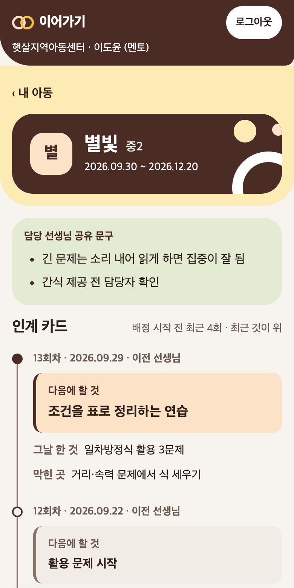
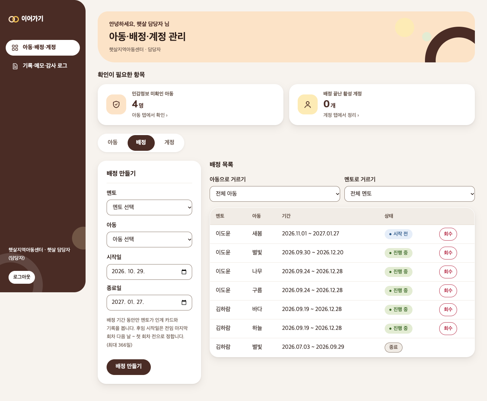
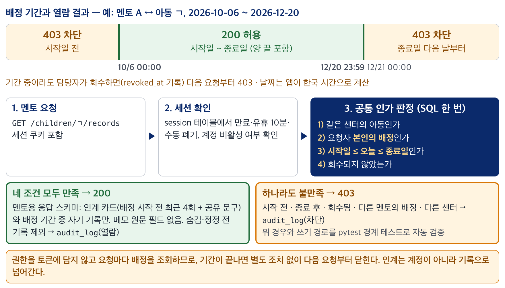

# 이어가기

지역아동센터 봉사 멘토가 바뀌어도 아이의 학습 기록이 이어지게 하는 인계 수첩 웹 서비스. 멘토는 담당자가 정한 **배정 기간에만** 아이의 기록을 볼 수 있다.

🏆 **2026 SW개발보안 경진대회 자유주제 부문 우수상** (첨단분야 혁신융합대학 사업협의회장상)


[▶ 시연 영상 (YouTube)](https://youtu.be/NphndDwIK5k) · 팀 임팩트 · 2026.09 ~ 2026.11

## 주요 기능

- **회차 기록**: 멘토가 회차마다 세 칸(그날 한 것 / 막힌 곳 / 다음에 할 것)을 적는다.
- **인계 카드**: 후임 멘토의 배정 시작일에 이전 기록 최근 4회와 담당자 공유 문구가 열린다.
- **기간 = 권한**: 배정이 끝나거나 회수되면 다음 요청부터 기록이 닫힌다. 담당자·시설장은 자기 센터 아동만 본다.
- **감사 기록**: 열람·작성·거부를 모두 남기고 담당자가 확인한다.

## 화면

| 인계 카드 (멘토 휴대폰) | 배정 관리 (담당자 PC) |
| --- | --- |
|  |  |
| **회수 직후 차단 (멘토)** | **감사 기록 (담당자)** |
|  |  |

화면 속 센터·멘토·아동은 모두 가상 데이터다.

## 구조


## 보안 설계 핵심

| 항목 | 내용 |
| --- | --- |
| 아동 단위 권한 확인 | 아동 데이터 API는 모두 [`authorize_child`](backend/app/authz/policy.py)를 거친다. 멘토는 센터·본인 배정·기간·회수 여부를 SQL 한 문장으로 판정하고, 권한을 토큰에 담지 않아 기간이 끝나면 바로 막힌다. |
| 권한 누락 방지 | 권한 타입이 없는 API는 자체 셈그렙(Semgrep) 규칙이 커밋 전 검사와 CI에서 막는다. |
| 세션 쿠키 | `__Host-` · HttpOnly · Secure · SameSite=Strict, 10분 유휴·8시간 절대 만료, 토큰은 DB에 HMAC 값으로만 저장 |
| CSRF 방어 | 상태를 바꾸는 요청은 Origin 허용 목록 미들웨어로 확인 |
| 메모 암호화 | 담당자 메모는 AES-256-GCM(메모마다 새 nonce, 메모·아동 ID를 AAD로 묶음), 키는 DB 밖 |
| 동시성·DB 강제 | 조건부 UPDATE로 확인과 사용 사이 틈 제거, 잠금 순서 고정, 배정 기간 겹침은 DB 배제 제약으로 차단, 앱 DB 계정은 필요한 칸만 수정 |
| 로그 마스킹 | 비밀번호·토큰·쿠키·본문 같은 값은 `***`, 운영 로그에는 예외 종류만 |
| 자동 점검 | 자체 셈그렙 규칙 26개, ruff · bandit · pip-audit · npm audit · ESLint · gitleaks, GitHub Actions CI |



파일 업로드·외부 API 호출·명령 실행은 처음부터 만들지 않았다. 전체 설계는 [docs/보안설계.md](docs/보안설계.md)에 있다.

## 기술 스택

| 구분 | 기술 |
| --- | --- |
| 백엔드 | Python 3.12 · FastAPI · SQLAlchemy 2 · Alembic · Pydantic 2 |
| 프론트엔드 | React 19 · React Router 7 · Vite 8 |
| DB·배포 | PostgreSQL 17 · Docker Compose · Caddy |
| 보안 점검 | Semgrep · ruff · bandit · pip-audit · npm audit · gitleaks |
| 코딩 보조 도구 | Claude Code |

## 실행 방법

준비물: Python 3.12, Node.js 26, PostgreSQL, [uv](https://docs.astral.sh/uv/), make

```bash
git clone https://github.com/jik0226/ieogagi.git && cd ieogagi
make setup
cd backend && cp .env.example .env && .venv/bin/ieogagi-dev-secrets && .venv/bin/ieogagi-db-roles && .venv/bin/alembic upgrade head && .venv/bin/ieogagi-seed && cd ..
```

터미널 두 개에서 `make dev-backend`, `make dev-frontend`를 실행하고 Chrome에서 http://localhost:5173 을 연다. 데모 계정은 `mentor_lee`·`sunny_staff`·`sunny_director`이고, 비밀번호는 `backend/.secrets/seed_accounts.txt`에 무작위로 만들어진다. 서버 배포는 [deploy/README.md](deploy/README.md)를 본다.

## 테스트

```bash
createdb ieogagi_test && make test   # 백엔드 테스트 136개
make security                        # 보안 점검
```

## 팀 소개

| 이름 | 역할 | 한 일 |
| --- | --- | --- |
| 정인겸 [@jik0226](https://github.com/jik0226) | PM·백엔드 | 기획, 백엔드·프론트엔드 개발, 보안 설계·점검, 결선 질의응답 |
| 김하은 [@khelove](https://github.com/khelove) | 프론트엔드 | ✏️ 디자인 테마로 화면 수정, 디자인 감수, 포스터 |
| 이채린 [@Chae102](https://github.com/Chae102) | 백엔드 보안 테스트 | ✏️ 공격 시나리오 15개로 API 점검(뚫린 곳 0건) |
| 김주환 [@emilk1031-crypto](https://github.com/emilk1031-crypto) | 발표·기획 지원 |  현장 설문·인터뷰, 결선 발표 |

1라운드 [개발기획서](docs/02_개발기획서_본문.md)의 역할 표기는 계획 단계 기준이다.

## 한계

- 실제 서버와 실제 센터에서는 운영해 보지 않았다(로컬 Docker·가상 머신에서 검증).
- 남의 아이디로 일부러 틀려 15분 잠금을 반복시키는 악용은 아직 막지 못한다.
- 암호 키를 바꾼 뒤 예전 메모를 다시 암호화하는 명령이 없다.

## 문서

[보안 설계](docs/보안설계.md) · [보안 점검](docs/보안점검/) · [API 설계](docs/API_설계.md) · [화면 목록](docs/화면목록.md) · [설계 자료](docs/design/) · [개발기획서](docs/02_개발기획서_본문.md). 문서 속 커밋 번호는 비공개 개발 저장소 기준이다.

## 라이선스

[MIT](LICENSE)
