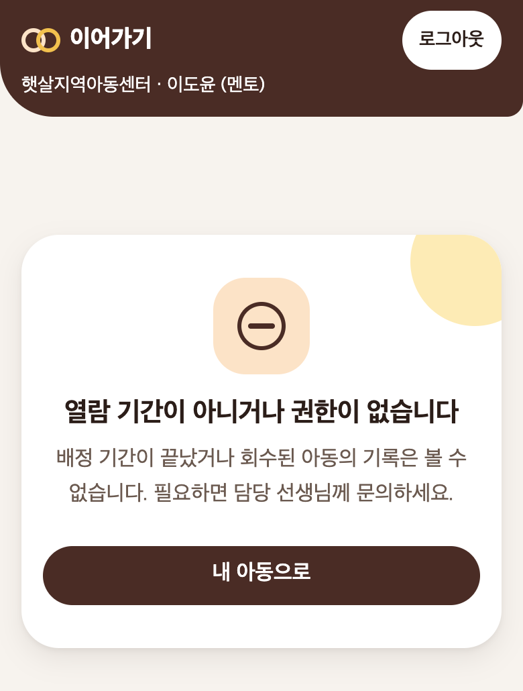
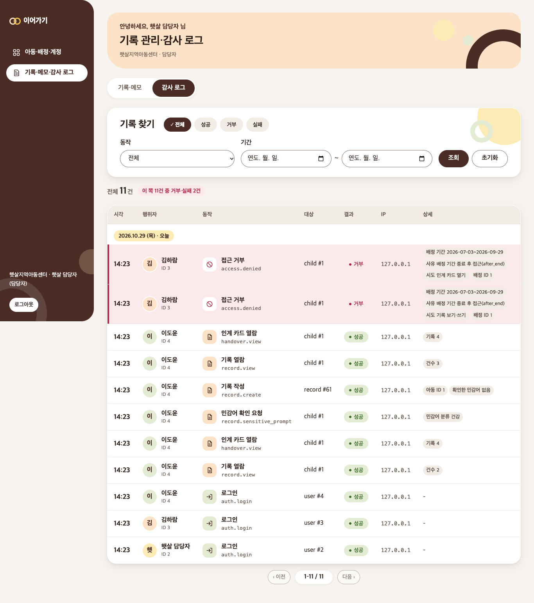
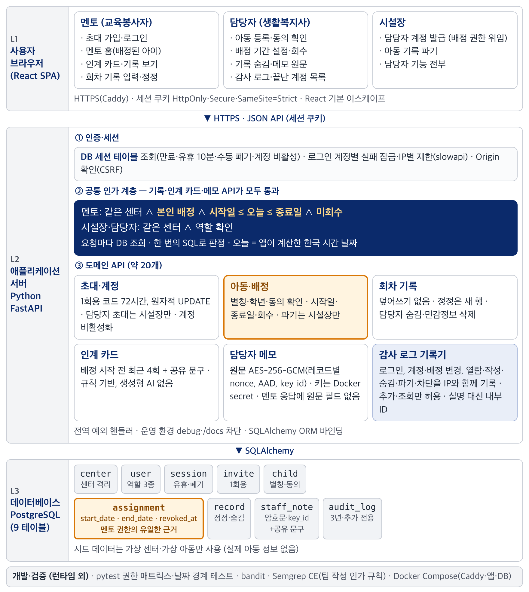

# 이어가기

> 지역아동센터의 봉사 멘토가 바뀌어도 아이의 학습 기록이 끊기지 않게 이어 주는 인계 수첩 웹 서비스.
> 멘토는 **담당자가 정한 배정 기간에만** 아이의 기록을 볼 수 있고, 기간이 끝나면 다음 요청부터 저절로 닫힌다.

**🏆 2026 SW개발보안 경진대회 결선 우수상** · 트랙 A(자유주제) · 팀 임팩트 · 2026.09 ~ 2026.11

**[▶ 시연 영상 보기 (YouTube)](https://youtu.be/NphndDwIK5k)**

| 항목 | 내용 |
| --- | --- |
| 사용자 | 멘토(교육봉사자, 휴대폰) · 담당자(생활복지사, PC) · 시설장 |
| 핵심 원칙 | **배정 기간이 곧 열람 권한이다** |
| 규모 | API 라우트 27개 · 테이블 9개 · 화면 6개 · 백엔드 테스트 136개 · 프론트 단위 테스트 3개 |
| 스택 | Python 3.12 · FastAPI · PostgreSQL · React · Docker Compose · Caddy |
| 보안 점검 | 자체 셈그렙(Semgrep) 규칙 26개 + 8단계 자동 점검, 마지막 점검(2026-11-21) 0건 |

## 문제와 해결

**문제.** 지역아동센터에서는 자원봉사자 2만 4천여 명이 활동한다(2023년 말 전국 통계). 학습을 돕던 봉사자가 바뀌면 새 봉사자는 짧은 만남 안에서 아이를 처음부터 다시 파악해야 한다. 팀이 한 작은 현장 설문(8명)에서도 이전 학습 상황을 충분히 알고 시작했다는 사람은 1명뿐이었다. 그렇다고 이전 기록을 보여 주려고 봉사자에게 아동 정보를 열어 주면, 봉사를 마친 사람에게도 열람 권한이 남는다.

**해결.** 인계와 권한 회수를 한 원칙으로 묶었다.

1. 멘토는 회차마다 세 칸(그날 한 것 / 막힌 곳 / 다음에 할 것)만 적는다.
2. 후임 멘토의 배정 시작일이 되면 이전 기록 최근 4회와 담당자의 공유 문구로 **인계 카드**가 열린다.
3. 멘토에게 기록은 담당자가 정한 배정 기간(시작일 ~ 종료일)에만 열린다. 담당자·시설장은 자기 센터의 아동만 볼 수 있다. 기간이 끝나거나 담당자가 회수하면 따로 손대지 않아도 **다음 요청부터** 닫힌다.

인계는 계정이 아니라 기록으로 넘어간다. 그래서 봉사를 마친 멘토는 다음 요청부터 그 아이의 기록을 볼 수 없다. 다만 이미 화면에서 본 내용이나 따로 옮겨 적은 것까지 되돌릴 수는 없다.

## 화면

| 인계 카드 (멘토 휴대폰) | 배정 관리 (담당자 PC) |
| --- | --- |
|  |  |
| **회수 직후 차단 (멘토)** | **감사 기록 (담당자)** |
|  |  |

화면의 센터·멘토·아동은 모두 시드 데이터로 만든 가상 정보다.

## 구조



브라우저(React SPA) → FastAPI → PostgreSQL 3계층이다. 실행 중에 외부 API·LLM·파일 업로드를 쓰지 않아서 공격 받을 수 있는 곳 자체가 좁다.

## 보안 설계 핵심

"약점이 생길 자리를 코드 구조에서 없앤다"가 기준이다. 권한 확인·예외 처리·로그·입력 검증·비밀값을 각각 **한 곳**에 모으고, 그 한 곳을 거치지 않으면 자동 규칙과 테스트가 빌드를 막게 했다.

| 무엇을 | 어떻게 | 코드 |
| --- | --- | --- |
| **아동 단위 권한 확인** | 아동 기록·인계 카드·메모를 다루는 API는 모두 `authorize_child` 하나를 거친다. 기록·메모 ID로 들어오는 담당자 API도 서비스 안에서 대상의 아동을 찾아 같은 함수를 부른다. 멘토는 "같은 센터 ∧ 본인 배정 ∧ 시작일 ≤ 오늘 ≤ 종료일 ∧ 회수 안 됨"을 SQL 한 문장으로 판정한다. 권한을 토큰에 담지 않고 요청마다 DB에서 읽기 때문에 기간이 끝나면 바로 막힌다. 거부 사유는 응답이 아니라 감사 로그에만 남긴다. | [`authz/policy.py`](backend/app/authz/policy.py) |
| **권한 확인 누락 방지** | 새 API는 인증·권한 타입(`CurrentUser`·`StaffUser`·`MentorChildAccess` 등) 중 하나를 매개변수로 선언하거나, 공개 경로라고 명시해야 한다. 둘 다 없으면 자체 셈그렙 규칙이 커밋 전 검사(pre-commit)와 CI에서 막는다. 이 규칙은 "권한 타입이 하나도 없는 API"를 잡고, 맞는 타입을 골랐는지는 권한 경계 테스트로 확인한다. | [`authz/deps.py`](backend/app/authz/deps.py), [`fastapi-authz.yml`](security/semgrep/fastapi-authz.yml) |
| **세션 쿠키** | `__Host-` 접두사 · HttpOnly · Secure · SameSite=Strict. 서버 세션은 10분 유휴·8시간 절대 만료이고, 쿠키 수명(Max-Age)도 유휴 만료와 같게(기본 10분) 두고 로그인된 요청의 응답마다 다시 발급해, 공용 PC 브라우저에 오래 남지 않는다. 세션 토큰은 DB에 HMAC-SHA256 값으로만 저장한다. | [`auth/cookies.py`](backend/app/auth/cookies.py), [`auth/sessions.py`](backend/app/auth/sessions.py) |
| **요청 위조(CSRF) 방어** | 상태를 바꾸는 요청(POST·PUT·PATCH·DELETE)은 Origin 헤더가 허용 목록에 있을 때만 받는 미들웨어를 둔다. SameSite=Strict 쿠키와 함께 별도 토큰 없이 막는다. | [`middleware.py`](backend/app/middleware.py) |
| **담당자 메모 암호화** | 건강·가정 사정 같은 메모 원문은 AES-256-GCM으로 암호화한다. 메모마다 새 난수(nonce)를 쓰고, 메모 ID·아동 ID를 추가 인증 데이터(AAD)로 묶어 다른 행으로 옮긴 암호문은 풀리지 않는다. 키는 DB 밖 비밀 파일에 두고 `key_id`로 교체할 수 있다. 멘토용 응답에는 원문 칸 자체가 없다. | [`security/crypto.py`](backend/app/security/crypto.py) |
| **동시성과 DB 수준 강제** | 세션 확인·초대 코드 사용·로그인 시도 차감은 조건부 UPDATE 한 문장으로 처리해, 확인과 사용 사이의 틈(TOCTOU)을 없앴다. 쓰기는 기록 → 배정 → 아동 행 순서로 잠가 교착을 막는다. 같은 멘토·아동의 배정 기간은 DB 배제 제약(`EXCLUDE USING gist`)으로 겹칠 수 없고, 앱용 DB 계정은 감사 로그에 추가·조회만, 다른 표도 코드가 바꾸는 칸만 고칠 수 있다. | [`authz/policy.py`](backend/app/authz/policy.py), [`0003 마이그레이션`](backend/alembic/versions/20261011_0003_integrity_and_column_grants.py) |
| **로그 마스킹** | 로그는 JSON으로 남기고, 덧붙이는 필드는 허용 목록에 있는 것만 쓴다. 이름이 비밀번호·토큰·초대 코드·쿠키·세션·본문 등인 값은 `***`로 가리고(중첩된 값까지, 깊이 5를 넘으면 통째로), 문장 속 `password=…`·`token=…` 같은 값도 가린다. 오류 추적 내용은 운영이 아닌 환경에서만 같은 규칙으로 가려 남기고, 운영에서는 예외 종류만 남긴다. SQL 바인딩 값은 로그와 예외 메시지에 들어가지 않는다. | [`logging_setup.py`](backend/app/logging_setup.py) |
| **자동 점검** | 자체 셈그렙 규칙 26개(백엔드 17·프론트 9)와 규칙 자체 테스트, `make security` 8단계 점검(ruff · bandit · 자체 규칙 · 공식 규칙 백엔드/프론트 · pip-audit · npm audit · ESLint), gitleaks 비밀값 검사, GitHub Actions CI. | [`security/`](security/), [`security_scan.sh`](scripts/security_scan.sh) |


**그 밖에**: 비밀번호 argon2id 저장 · 계정별 5회 실패 시 15분 잠금 · IP별 요청 제한 / 전역 예외 처리로 내부 오류 문구를 응답에 넣지 않음 / 의존성 해시 고정 / 배포 컨테이너는 읽기 전용·root 아님.

**처음부터 만들지 않은 기능**: 파일 업로드, 외부 API·LLM 호출, 운영체제 명령 실행, 위험한 역직렬화(pickle 등), 리다이렉트. 이런 약점이 생길 코드 경로가 아예 없다. 나중에 들어오지 않게 명령 실행·`eval`·역직렬화·변수 주소 리다이렉트는 자체 셈그렙 규칙으로, 외부 요청 코드는 ruff·bandit로 잡고, 실행 중 외부 통신은 배포의 내부 네트워크가 막는다.

설계 단계 예방 기법 25개 전체는 [docs/보안설계.md](docs/보안설계.md)에 있다.

## 검증

- **마지막 점검(2026-11-21)**: `make security` 8단계 모두 0건, gitleaks(작업 폴더) 0건, 백엔드 테스트 136개·프론트 단위 테스트 3개 통과. 같은 점검을 GitHub Actions가 push마다 돌린다.
- **백엔드 테스트 136개**: 실제 PostgreSQL에 실제 마이그레이션을 적용하고, 앱은 운영과 같은 최소 권한 DB 계정으로 접속해 권한 설정까지 확인한다. 권한 경계 14개(시작일 전날, 종료일 다음 날 00:30 등)와 회수·파기 동시성 12개를 포함한다.
- **변이 검사**: 종료일 조건 `>=`를 `>`로 바꾸거나 한국 시간 변환을 지우면 테스트가 실제로 실패하는지 확인했다.
- **대회 공식 소스코드 진단 대응**: 2라운드 진단에서 나온 2건(빈 catch 블록, 만료 시각 없는 세션 쿠키)을 고치고 회귀 테스트로 고정했다. [조치 내역](docs/보안점검/2라운드_진단_개선조치.md)
- **보안약점 49항목 대조**: KISA 「소프트웨어 개발보안 가이드」의 구현 단계 보안약점 49개를 코드와 하나씩 대조했다. [체크리스트](docs/보안점검/49항목_체크리스트.md)

## 기술 스택

| 구분 | 기술 |
| --- | --- |
| 백엔드 | Python 3.12, FastAPI, SQLAlchemy 2, Alembic, Pydantic 2, argon2-cffi, cryptography, slowapi |
| 프론트엔드 | React 19, React Router 7, Vite 8 (Node.js 26) |
| 데이터베이스 | PostgreSQL 17 (개발은 16도 가능) |
| 배포 | Docker Compose, Caddy (HTTPS) |
| 보안 점검 | ruff, bandit, Semgrep CE, pip-audit, npm audit, ESLint, gitleaks, pre-commit |
| 개발 도구 | GitHub Actions, uv, AI 코딩 도구(Claude Code) |

## 실행 방법

준비물: Python 3.12, Node.js 26, PostgreSQL, [uv](https://docs.astral.sh/uv/), make. macOS는 Homebrew로 한 번에 설치한다.

```bash
brew install python@3.12 node postgresql@17 uv && brew services start postgresql@17
```

소스를 받아 설치하고, 개발용 비밀값·DB·가상 데이터를 만든다(처음 한 번).

```bash
git clone https://github.com/jik0226/ieogagi.git
cd ieogagi
make setup
cd backend && cp .env.example .env && .venv/bin/ieogagi-dev-secrets && .venv/bin/ieogagi-db-roles && .venv/bin/alembic upgrade head && .venv/bin/ieogagi-seed && cd ..
```

- `ieogagi-dev-secrets`는 DB 비밀번호·세션 키·메모 암호 키를 `backend/.secrets/`에 무작위로 만든다. 이 폴더와 `.env`는 git에 올라가지 않는다.
- `ieogagi-seed`는 가상 센터 2곳·멘토 4명·아동 12명·기록 60건을 만든다. 실제 아동 정보는 없다.

터미널 두 개에서 서버를 띄운다.

```bash
make dev-backend
```

```bash
make dev-frontend
```

Chrome에서 http://localhost:5173 을 연다. 데모 계정은 멘토 `mentor_lee`, 담당자 `sunny_staff`, 시설장 `sunny_director`이고, 비밀번호는 PC마다 무작위로 만들어져 `backend/.secrets/seed_accounts.txt`에 저장된다.

- **Windows**: WSL2의 Ubuntu 24.04 안에서 같은 명령을 쓴다(`apt`로 git·make·postgresql 설치, nvm으로 Node.js 26 설치). 소스는 `C:\` 아래가 아니라 WSL 홈 폴더에 받는다.
- **Chrome 권장**: 로그인 쿠키가 `__Host-` 접두사와 Secure 속성을 쓰므로, `localhost`를 안전한 주소로 취급하는 브라우저에서만 저장된다.
- **주소는 `localhost:5173` 그대로**: 다른 포트나 `127.0.0.1`로 열면 Origin 허용 목록에 없어 로그인이 403으로 막힌다.
- **처음 상태로 돌리기**: `cd backend && .venv/bin/ieogagi-seed --reset && cd ..` (비밀번호도 새로 만들어진다)

실제 서버 배포(Docker Compose·Caddy·백업·복구·키 교체)는 [deploy/README.md](deploy/README.md)에 있다.

## 테스트와 점검

| 명령 | 하는 일 |
| --- | --- |
| `make test` | 백엔드 테스트(테스트용 DB가 필요하다: `createdb ieogagi_test`) |
| `npm --prefix frontend test` | 프론트 단위 테스트(Node 내장 테스트 도구) |
| `make lint` | ruff + ESLint |
| `make security` | 8단계 보안 점검, 결과는 `security/reports/`에 저장 |
| `make security-quick` | 인터넷 없이 도는 빠른 점검(ruff·bandit·자체 규칙) |
| `make semgrep-test` | 자체 셈그렙 규칙 자체 테스트 |
| `make secrets-scan` | git 이력과 작업 폴더의 비밀값 검사(gitleaks) |

## 폴더 구성

```
backend/    FastAPI 앱(app/), 마이그레이션(alembic/), 테스트(tests/)
frontend/   React 화면 6개(멘토 휴대폰·담당자 PC)와 공통 상태 화면(403·404·오류·로딩)
deploy/     Docker Compose(Caddy HTTPS·앱·DB) 배포 구성과 운영 문서
security/   자체 셈그렙 규칙 26개와 규칙 테스트
scripts/    보안 점검 일괄 실행(security_scan.sh)
docs/       기획서, API 설계, 화면 목록, 보안 설계, 보안 점검 기록
.github/    CI(보안 점검·백엔드 테스트·프론트 빌드)
```

## 팀 소개

팀 임팩트, 4명. 각자 한 일은 이 저장소와 대회 제출 자료에서 확인되는 것만 적었다.

| 이름 | 역할 | 한 일 |
| --- | --- | --- |
| 정인겸 [@jik0226](https://github.com/jik0226) | PM·백엔드 | 기획·일정 관리, 백엔드·프론트엔드 개발(AI 코딩 도구 Claude Code 활용), 보안 설계·자동 점검과 조치, 대회 제출, 결선 질의응답 |
| 김하은 [@khelove](https://github.com/khelove) | 프론트엔드 | '따뜻한 수첩' 디자인 테마로 멘토·담당자 화면과 감사 기록 화면 수정, 디자인 감수, 사용성 자체 점검, 포스터 |
| 이채린 [@Chae102](https://github.com/Chae102) | 백엔드 보안 테스트 | 공격 시나리오 15개로 API를 직접 점검(배정 기간 밖 접근, 주소를 바꿔 남의 기록 열기 등, 뚫린 곳 0건) |
| 김주환 [@emilk1031-crypto](https://github.com/emilk1031-crypto) | 발표·기획 지원 | 현장 검증(설문 8명·멘토 인터뷰 1명)으로 요구 확인, 사용성 자체 점검, 결선 발표 |

1라운드 개발기획서 표지의 역할(백엔드 2명·프론트엔드 1명·데이터·테스트 1명)은 계획 단계 기준이고, 실제로는 위처럼 나눴다.

### AI 코딩 도구를 쓴 방식

코드와 문서 초안은 팀장이 AI 코딩 도구(Claude Code)로 작성했다. 사람이 정할 것과 도구에 맡길 것을 이렇게 나눴다.

- **사람이 정함**: "배정 기간 = 열람 권한" 원칙, 만들지 않을 기능(파일 업로드·외부 호출 등), 보안 핵심(인증·인가·암호화·감사 로그)의 검토와 테스트
- **도구에 맡기고 팀이 검토**: 프론트엔드 골격, 점검 도구 설정, 체크리스트 초안
- **도구의 실수를 기계가 잡게 함**: 권한 누락을 막는 셈그렙 규칙, 커밋 전 검사, CI, 변이 검사. 예를 들어 한국 시간 변환 코드를 지워도 테스트가 통과하던 문제를 변이 검사로 찾아, 테스트 시계를 실제 시계처럼 UTC로 바꿔 고쳤다.

## 한계와 다음 할 일

- **실제 서버에는 배포하지 않았다.** 배포 구성은 로컬 Docker와 리눅스 가상 머신에서 검증했다. 공인 도메인·인증서 배포는 운영 기관이 정해지면 같은 절차로 확인한다.
- **실제 센터에서 운영해 보지 않았다.** 현장 확인은 설문 8명·멘토 인터뷰 1명 규모였고, 센터 종사자 인터뷰는 하지 못했다.
- **현장 선호와 다른 원칙**: 기간이 끝나면 기록이 닫히는 방식에 찬성(5점 중 4~5점)한 응답자는 8명 중 2명이었다. 그래서 이 원칙의 근거는 현장 선호가 아니라 「개인정보의 안전성 확보조치 기준」 제5조 ②(업무가 바뀌면 접근 권한을 지체 없이 변경·말소)에 두었다. 법령이 자동 차단까지 요구하지는 않으며, 자동 차단은 이 의무를 사람의 기억에 맡기지 않으려는 팀의 설계 선택이다(법률 검토 전). 도입할 때는 닫는 이유와 다음 기간을 새 배정으로 잇는 방법을 먼저 설명해야 한다.
- **로그인 잠금 악용**: 남의 아이디로 일부러 비밀번호를 틀려 15분 잠금을 반복시키는 경우를 아직 막지 못한다. 실패할수록 대기 시간을 늘리는 방식 등으로 보완할 예정이다.
- **암호 키 교체 뒤 재암호화 명령이 없다.** 지금은 이전 키를 그 키로 암호화한 메모가 파기될 때까지 남겨 두는 방식이다.
- **동의 안내문은 법률 검토 전 초안이다.**

## 대회 이력

이 공개 저장소는 개인정보와 대회 내부 자료를 빼고 정리한 새 기록으로 시작했다. 개발 과정(테스트 68개 → 136개, 점검 이력)은 [docs/보안설계.md](docs/보안설계.md) 3절에 있고, 문서 속 커밋 번호는 비공개 개발 저장소 기준이다.

| 날짜 | 내용 |
| --- | --- |
| 2026.09.25 | 1라운드 개발기획서 제출 → 10.06 서면평가 통과 |
| 2026.10.30 | 2라운드 결과물(소스·시연 영상·발표자료 등) 제출 → 결선 진출(11팀) |
| 2026.11.05 | 2라운드 공식 소스코드 진단 2건 개선 |
| 2026.11.18 | 광주 결선 발표·질의응답·현장 인터뷰 |
| 2026.11 | **결선 우수상** |

## 더 읽을 문서

| 문서 | 내용 |
| --- | --- |
| [docs/보안설계.md](docs/보안설계.md) | 설계 단계 보안 예방 기법 25개, 점검 이력, 설계 결정 기록 |
| [docs/보안점검/](docs/보안점검/) | 49항목 체크리스트, 점검 도구 사용법, 예외 대장, 공식 진단 조치 내역 |
| [docs/API_설계.md](docs/API_설계.md), [docs/api/openapi.json](docs/api/openapi.json) | API 요약과 정본 스키마 |
| [docs/화면목록.md](docs/화면목록.md), [docs/design/](docs/design/) | 화면 6개, 와이어프레임, ERD, 아키텍처 |
| [docs/02_개발기획서_본문.md](docs/02_개발기획서_본문.md) | 1라운드 개발기획서(문제 근거·기존 서비스 비교) |
| [deploy/README.md](deploy/README.md) | 운영 문서: 설치·백업·복구·업데이트·키 교체 |

## 라이선스

[MIT](LICENSE)
