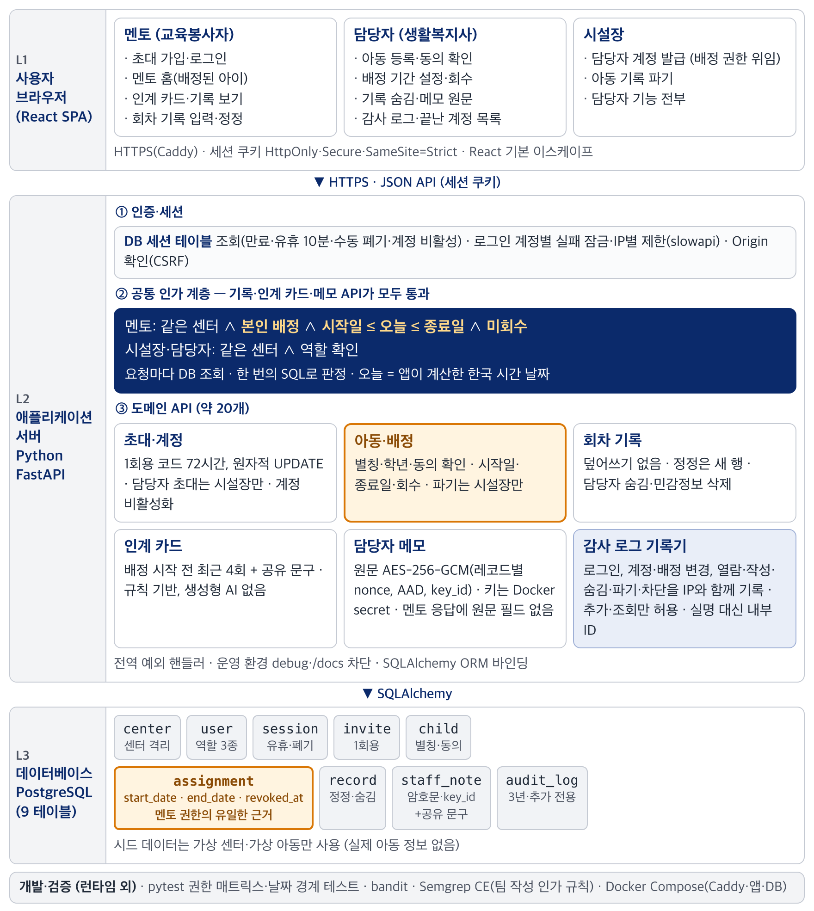
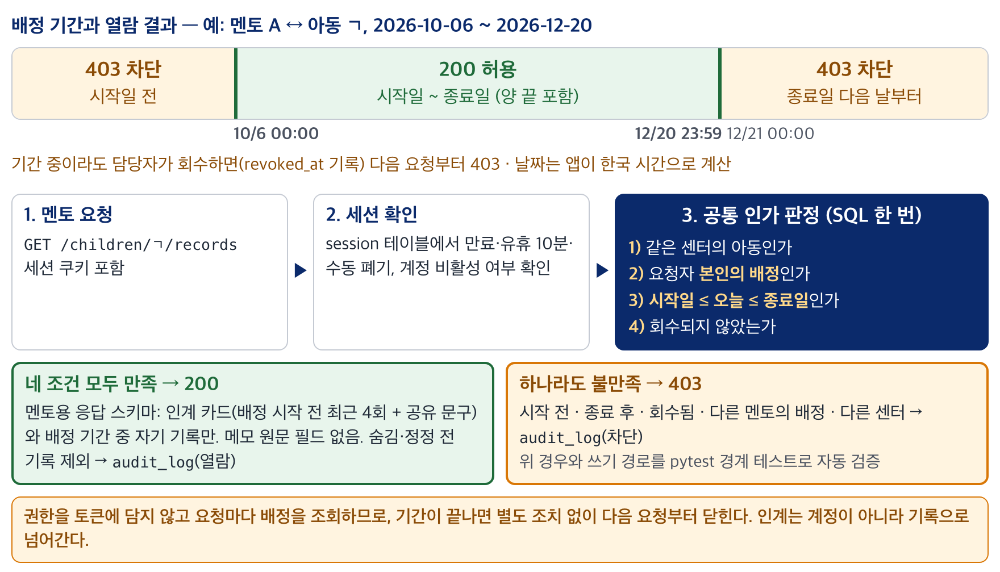

# 「이어가기」 개발기획서 본문 — 2026 SW개발보안 경진대회 1라운드 (트랙 A)

2026 SW개발보안 경진대회 1라운드에 제출한 개발기획서의 본문이다(제출 2026-09-25). 그림은 `assets/`에 있다.

## 표지

| 항목 | 내용 |
|---|---|
| 지원트랙 | ■ 트랙A : 자유주제 부문 □ 트랙B : 기술혁신 부문 □ 트랙C : 공공활용 부문 |
| 팀명 | 임팩트 |
| 개발언어 | Python |
| 프로젝트명 | 이어가기 |
| 프로젝트 소개 | 지역아동센터 교육봉사자가 바뀔 때 후임이 아동별 학습 지도 기록을 이어받는 인계 수첩. 회차 기록으로 인계 카드를 만들고, 기록은 배정 기간에만 열린다. |
| 팀 소개 및 팀원별 역할 | 백엔드 2명(인증·인가·암호화 / 감사 로그·담당자 API), 프론트엔드 1명(React 화면 6개), 데이터·테스트 1명(권한 매트릭스·경계 테스트·Semgrep 규칙). 팀장이 기획·발표를 겸한다. |

## ❶ 추진 배경 및 필요성

### 1. 문제와 해결 범위

지역아동센터에는 자원봉사자 2만 4천여 명이 활동한다(2023년 말 기준, 아래 ③). 학습 지도를 맡은 교육봉사자(서비스 안에서는 멘토)가 바뀌면 아동에게 부담이 되고, 새 봉사자는 짧은 만남 안에서 아동을 다시 파악해야 한다(아래 ①).

이어가기는 후임 봉사자가 이전 봉사자의 학습 지도 내용을 이어받는 과정만 다룬다. 봉사자 모집이나 교체 감소는 범위 밖이다.

봉사자에게 아동 기록을 전산으로 열어 주면, 봉사를 마친 사람에게 열람 권한이 남는 위험이 생긴다. 그래서 이어가기는 인계와 회수를 한 원칙으로 묶는다. **"배정 기간이 곧 열람 권한이다."** 센터 담당자(생활복지사)가 정한 봉사자–아동 배정의 시작일부터 종료일까지만 기록이 열리고, 기간 밖이거나 회수되면 다음 요청부터 닫힌다.

### 2. 근거

**① 현장 연구: 교체와 짧은 만남의 부담**

박신희(2019), 「'돌봄'과 '배움'의 관점에서 본 지역아동센터 일상에서의 아동의 경험」, 조선대학교 박사학위논문(주 참여관찰 2014.8~2015.2, 추가 관찰 2018년까지). 센터장은 "선생님들이 바뀌면 애들이 눈치를 보거든요?"라고 말한다(150쪽). 연구자는 방학 중 대학생 봉사자의 수학 지도가 개학으로 중단돼 중학생이 혼자 공부하게 된 사례를 들어 "비상근교사들의 잦은 교체는 아동들의 정서뿐만 아니라 학습에도 부정적인 영향을 미치고 있다"고 정리한다(150쪽). 봉사자를 포함한 비상주교사와 아동은 주 1회 1~2시간 정도 만나고(148쪽), 이런 만남에서는 교사들이 아동들의 "필요나 요구에 귀를 기울일 기회를 갖지 못하게" 된다는 서술도 있다(180쪽).

**② 규정: 봉사자의 일지·비밀 유지 의무와 종사자 전용 시스템**

| 근거 | 내용 |
|---|---|
| 보건복지부 『2025년 지역아동센터 지원 사업안내』 부록 「운영규정 예시」 제35조 ①② | 봉사자는 활동 후 일지를 작성하고, 아동에 대해 알게 된 중요한 정보는 시설에 알리고 비밀을 지킨다 |
| 같은 예시 제38조 ④⑤ | 아동 상담·사례관리 기록은 접근권한을 설정해 시설장 허가로만 열람하고, 개별 아동 관리카드·관찰일지·상담 기록은 희망이음(사회서비스정보시스템)으로 관리한다 |
| 아동권리보장원 『2026년 지역아동센터 평가사업 안내』 48쪽 | 평가지표 1-2(개인정보보호)의 권한 제한 항목에서 "사회서비스정보시스템(희망이음) 사용 권한 부여를 시ㆍ군ㆍ구에 임면 보고된 종사자로 제한하는 규정(지침)이 확인됨"을 평가한다 |

운영규정 예시는 센터가 실정에 맞게 고쳐 쓰는 기준 문서다. 이 예시는 봉사자에게 일지와 비밀 유지를 요구하고, 평가 기준은 공식 아동 기록 시스템의 사용 권한을 종사자로 한정한다. 검토한 공식 문서(위 사업안내의 서식 1~32호, 『2025 1365 자원봉사포털 관리자 실무 가이드』, 『2026년도 대학생 청소년교육지원장학금 업무처리기준(안)』)에는 봉사자 사이의 인계 서식이나 절차가 나오지 않는다. 청소년교육지원장학금 기준의 참고용 동의서(별첨 10)는 '제공받는 자'에 멘토 대학생을, 보유 기간에 '사업 종료 후 5년'을 적었다. 그러나 활동이 끝날 때 멘토가 받은 정보를 회수·파기하는 절차는 기준에 없다. 이어가기는 센터마다 구두나 자체 양식으로 하던 인계를 아동 단위 기록과 배정 기간에 맞춘다.

**③ 통계: 봉사자 규모와 종사자 근속**

보건복지부·아동권리보장원 『2023년 12월 말 기준 전국 지역아동센터 통계조사 보고서』(2024.12)에서 자원봉사자는 24,299명(84~85쪽)으로 종사자 9,267명(59쪽)의 2.6배다. 인계를 챙길 생활복지사도 45.8%가 현재 센터 근무 3년 미만이다(64쪽 표에서 합산). 봉사자와 담당자가 모두 바뀌므로, 인계 내용은 사람보다 아동 기록에 남기는 편이 안전하다.

**④ 기존 소프트웨어(공개 문서 기준)**

- Mentorloop: 종료된 관계(closed loop)의 대화와 이력은 "remain accessible to you at any time"이라고 안내한다. 새 메시지는 보낼 수 없고 열람만 된다.
- Together: 종료 신호(SCIM)를 받아도 "historical mentorship activity is not unintentionally lost"를 이유로 계정을 관리자 검토 대기열로 보낸다.
- Apricot(Bonterra): 안내 문서는 Guest User 역할의 권장 열람 권한을 자기가 만든 레코드로 설명한다. 이 설정에서는 이전 봉사자의 기록을 이어 읽을 수 없다.

확인한 세 제품의 공개 문서에는 멘토–아동 배정 기간에 맞춰 열람을 여닫는 기능이 없다.

### 3. 기존 방식과 비교한 독창성

| | 기록 단위 | 다음 봉사자 인계 | 활동 종료 후 열람 |
|---|---|---|---|
| 희망이음 | 아동 (종사자 기록) | 봉사자는 사용 대상 아님 | 해당 없음 |
| 1365 자원봉사포털 | 활동처 × 일감 | 가이드에 없음 | 해당 없음 (실적 인증용) |
| 대학생 청소년교육지원장학금 | 출근부 (날짜 × 멘토) | 중단 사유서 (후임 항목 없음) | 기준에 회수 절차 없음 |
| 해외 멘토링 SW | 매칭(관계) | 공개 문서에 없음 | 관계 종료 후 열람 유지 또는 사용자 단위 처리 |
| **이어가기** | **아동** | **인계 카드 (배정 시작 전 최근 4회)** | **배정 기간 밖이면 차단** |

① 기록을 봉사자·날짜별이 아니라 아동별로 쌓는다. ② 후임에게 넘길 인계 산출물(인계 카드)을 만든다. ③ 기간 제한 인가는 알려진 방식이지만, 이를 절차가 없던 봉사자 인계에 적용해 열람 권한을 배정 기간 데이터에 연결한다.

### 4. 근거의 한계

- 현장 연구는 2014~2015년 참여관찰과 2018년까지의 추가 관찰 자료이고, 인용한 학습 중단 사례는 후임이 없던 경우다. 현재도 같다고 단정하지 않는다.
- 인계 누락이 사고로 이어졌다는 자료는 찾지 못해, 목표를 사고 예방이 아니라 인계의 연속성과 권한 회수로 둔다.
- 인계 절차는 공식 문서로만 확인했다. 센터 현장의 실제 인계 방식과 봉사자 개인의 활동 기간 통계는 조사하지 못했고, 로그인해야 문서를 볼 수 있는 제품(MentorcliQ·Chronus·ETO·Civicore)은 비교에서 뺐다.
- 효과는 아직 측정된 바 없고, 2라운드 개발 기간에 가상 데이터와 시연 리허설로 확인한다(❸ 5절).

## ❷ 주요 기능 및 개발환경

### 1. 서비스 개요와 설계 원칙

이어가기는 지역아동센터의 시설장·담당자(생활복지사)와 멘토(교육봉사자)가 쓰는 웹 서비스다. 아동·보호자 계정은 없다.

- **배정 기간이 곧 열람 권한이다.** 멘토는 자신에게 배정된 아동의 기록을 배정 시작일부터 종료일까지만 본다. 권한을 토큰에 담지 않고 요청마다 DB의 배정과 비교한다.
- **멘토가 읽는 범위는 정해져 있다.** 인계 카드(배정 시작 전 최근 4회 기록 + 담당자가 쓴 공유 문구)와 배정 기간 중 자기가 쓴 기록뿐이다. 아동의 전체 기록과 담당자 메모 원문은 시설장·담당자만 본다.
- **인계는 기록으로 넘어간다.** 계정은 물려주지 않는다. 후임의 배정 시작일부터 인계 카드가 열린다. 담당자는 후임 시작일을 전임의 마지막 회차 다음 날부터 후임의 첫 회차 전 사이로 잡아, 전임 기록이 모두 카드에 들어가고 후임이 미리 읽게 한다.

### 2. 사용자와 역할

| 역할 | 누구 | 할 수 있는 것 |
|---|---|---|
| 시설장 | 센터장 | 담당자 계정 발급·비활성화(배정 권한 위임), 아동 기록 파기, 담당자의 모든 기능 |
| 담당자 | 시설장이 지정한 생활복지사 | 멘토 초대·비활성화, 아동 등록, 배정 기간 설정·회수, 기록 숨김, 담당자 메모 작성·원문 열람, 감사 로그 조회 |
| 멘토 | 교육봉사자 | 배정된 아동의 회차 기록 작성·정정, 배정 기간 안에서 인계 카드·자기 기록 열람 |

### 3. 주요 기능

| # | 기능 | 설명 | 사용자 |
|---|---|---|---|
| F1 | 초대 가입·로그인 | 1회용 초대 코드(72시간)로 가입하고, 담당자 초대는 시설장만 발급한다. 비밀번호는 10자 이상·argon2 해시, 5회 연속 실패 시 15분 잠금. 세션은 DB 테이블로 관리한다(유휴 10분·절대 만료·수동 폐기) | 전원 |
| F2 | 아동 등록 | 별칭과 학년만 입력한다. 생년월일·주소·보호자 연락처는 받지 않는다. 개인정보 처리 동의와 민감정보 별도 동의(또는 법령상 근거)를 따로 확인한다 | 담당자 |
| F3 | 배정 관리 | 멘토↔아동 배정에 시작일·종료일을 정하고, 종료 전에도 회수할 수 있다 | 담당자 |
| F4 | 회차 기록 | 오늘 한 것 / 막힌 곳 / 다음에 할 것, 세 칸을 적는다. 학습 내용만 적도록 안내하고, 건강·가정 관련 단어가 있으면 저장 전에 다시 확인한다 | 멘토 |
| F5 | 인계 카드 | 배정 시작일 이전 기록 중 최근 4회와 담당자의 공유 문구를 규칙으로 모아 보여 준다. 생성형 AI를 쓰지 않는다 | 멘토 |
| F6 | 기록 보기 | 멘토는 인계 카드와 배정 기간 중 자기 기록을, 담당자는 아동의 전체 기록을 시간순으로 본다 | 멘토·담당자 |
| F7 | 담당자 메모 | 건강·가정 관련 원문은 암호화해 담당자만 본다. 멘토에게는 담당자가 쓴 공유 문구(예: "간식 제공 전 담당자 확인")만 보인다. 민감정보 확인 전에는 원문을 입력할 수 없다 | 담당자 |
| F8 | 정정·숨김·파기 | 기록은 덮어쓰지 않는다. 멘토는 정정 기록을 덧붙이고, 담당자는 부적절한 기록을 사유(선택 목록)와 함께 숨기며 민감정보가 든 칸은 내용만 지운다(행·감사 기록은 남김). 시설장은 보유 목적이 끝난 아동의 기록을 파기한다 | 전원 |
| F9 | 기간 밖 차단 | 시작일 전·종료일 후·회수 후 요청은 403으로 차단한다. 배정이 끝난 활성 계정은 담당자 화면에 표시하고, 비활성화하면 세션을 모두 폐기한다 | 시스템·담당자 |
| F10 | 감사 로그 | 로그인, 계정·배정 변경, 열람·작성·숨김·파기·차단을 접속 IP와 함께 기록한다. 아동 실명 대신 내부 ID를 쓴다 | 담당자 |

화면은 6개다. ① 로그인·초대 가입 ② 멘토 홈(배정된 아동 목록) ③ 인계 카드·기록 보기 ④ 회차 기록 입력·정정 ⑤ 담당자·시설장: 아동·배정·계정 관리 ⑥ 담당자·시설장: 기록 관리(숨김·메모, 파기는 시설장)·감사 로그.

### 4. 상세 기능구성도 (시스템 아키텍처)

브라우저(React SPA) → Python FastAPI → PostgreSQL의 3계층이다. 런타임에 외부 API·LLM·파일 업로드를 쓰지 않는다. 구성은 [그림 1], 권한 판정은 [그림 2]와 같다.

[그림 1] 이어가기 시스템 아키텍처 구성도

- **브라우저 계층**: React SPA 하나에 멘토 화면 4개(로그인 포함)와 담당자·시설장 화면 2개가 있다. 세션 쿠키(HttpOnly·Secure·SameSite=Strict)로 인증하고 React 기본 이스케이프로 출력한다.
- **애플리케이션 계층(FastAPI)**: 요청은 ① 인증·세션 확인 → ② 공통 인가 계층 → ③ 도메인 API 순서로 흐른다. 기록·인계 카드·메모 API는 모두 공통 인가 함수 하나를 거친다. 계정·배정 변경과 열람·작성·차단 이벤트는 모두 감사 로그 기록기가 남긴다.
- **데이터 계층(PostgreSQL)**: 9개 테이블. 그중 assignment(시작일·종료일·회수 시각)가 멘토 권한의 유일한 근거다.

**공통 인가 계층의 판정 조건**: 멘토 요청은 "같은 센터 ∧ 요청자 본인의 배정 ∧ 시작일 ≤ 오늘 ≤ 종료일 ∧ 회수되지 않음"을 모두 만족해야 한다. "오늘"은 애플리케이션이 한국 시간(Asia/Seoul) 기준 날짜로 계산해 SQL 파라미터로 넘긴다. DB의 CURRENT_DATE는 쓰지 않고, 인계 카드의 "시작일 이전" 비교도 같은 한국 시간 날짜로 한다. 네 조건은 한 번의 SQL로 판정한다. 허용되면 멘토용 응답 스키마(인계 카드 범위와 자기 기록만, 메모 원문 필드 없음)로 내려주고 열람을 기록한다. 거부되면 403을 돌려주고 차단을 기록한다. 세션 확인 단계에서는 계정의 비활성 여부도 요청마다 확인한다. 시설장·담당자 요청은 같은 센터인지와 역할로 판정한다.

[그림 2] 배정 기간이 열람 권한을 결정하는 흐름

**인가 경계 테스트**: 아래 상황을 pytest로 자동 검증한다. 날짜는 테스트 코드에서 고정해 경계 전후를 재현한다.

| 테스트 상황 | 기대 결과 |
|---|---|
| 다른 멘토에게 배정된 아동의 기록 요청 | 403 |
| 시작일 전날 요청 | 403 |
| 시작일 당일, 종료일 당일 요청 | 200 |
| 종료일 다음 날 00:30(한국 시간) 요청 | 403 |
| 회수 직후의 다음 요청 | 403 |
| 비활성화 직후 기존 세션으로 요청 | 401 |
| 멘토·담당자가 다른 센터의 아동·기록·감사 로그 요청 | 403 |
| 다른 멘토·다른 아동의 기록을 정정 대상으로 지정 | 403 |
| 배정 기간 밖에 회차 기록 작성 | 403 |
| 숨김 처리된 기록, 정정 전 원 기록 | 멘토 응답에서 제외 |
| 멘토가 메모 원문·감사 로그 API 호출 | 403 |
| 담당자가 담당자 계정 발급·파기 API 호출 | 403 (시설장 전용) |
| 담당자가 시설장·다른 담당자 계정 비활성화 | 403 |
| 민감정보 항목이 확인되지 않은 아동에 메모 원문 작성 | 거부 |

### 5. 데이터 모델과 API

| 테이블 | 핵심 컬럼 | 비고 |
|---|---|---|
| center | id, name | 센터 단위 격리의 기준 |
| user | id, center_id, role(시설장/담당자/멘토), password_hash, failed_count, locked_until, disabled_at | 역할 3종, 로그인 실패 잠금 |
| session | token_hash, user_id, expires_at, last_seen_at, revoked_at | 유휴 10분·수동 폐기 판정 |
| invite | code_hash, center_id, role, expires_at, used_at | 72시간·1회용, 원자적 UPDATE로 사용 처리 |
| child | id, center_id, alias, grade, consent_at, sensitive_basis_at | 별칭·학년과 확인 시각 2개(개인정보 처리 동의 / 민감정보 동의 또는 근거) |
| assignment | mentor_id, child_id, start_date, end_date, revoked_at, created_by | 멘토 권한의 유일한 근거 |
| record | child_id, author_id, did, stuck, next, corrects_id, hidden_at, hidden_reason_code, created_at | 덮어쓰기 없음(민감정보 삭제만 예외). 정정은 새 행 |
| staff_note | child_id, ciphertext, nonce, key_id, share_text | 원문은 AES-256-GCM, 공유 문구는 담당자가 작성 |
| audit_log | center_id, actor_id, action, target_type, target_id, result, ip, detail(배정 기간·사유 코드), created_at | 최소 3년 보관. 앱 실행 계정은 INSERT·SELECT만 |

파기하면 해당 아동의 record·staff_note·assignment·child 행을 삭제한다. audit_log의 기존 기록은 아동 실명 없이 내부 ID만 담고 있으므로 보관 기준대로 두고, 파기 사실을 새로 기록한다. 백업본에 남은 기록은 백업 보관 주기가 지나 덮어써질 때 사라지며, 이 주기를 운영 문서에 적는다.

API는 약 20개다. 인증 4개(초대 코드 검증·가입·로그인·로그아웃), 계정 3개(초대 발급·계정 목록·비활성화), 아동·배정 6개(아동 등록·아동 목록·배정 생성·조회·회수·아동 파기), 기록 6개(내 배정 목록·회차 기록 작성과 정정·기록 보기·인계 카드·숨김·민감정보 삭제), 담당자 메모 2개(작성·원문 조회), 감사 로그 조회 1개.

### 6. 개발환경

| 구분 | 내용 |
|---|---|
| 언어 | Python 3.12 이상(백엔드), JavaScript(프론트엔드) |
| 백엔드 | FastAPI, uvicorn(ASGI 서버), SQLAlchemy, psycopg(PostgreSQL 드라이버), argon2-cffi(비밀번호 해시), cryptography(AES-256-GCM), slowapi(요청 제한) |
| 프론트엔드 | React SPA(Vite) |
| 데이터베이스 | PostgreSQL |
| 테스트·점검 | pytest(권한 매트릭스·날짜 경계), bandit, Semgrep Community Edition(팀이 작성한 인가 규칙 포함) |
| 실행·배포 | Docker Compose로 리버스 프록시(Caddy, HTTPS 인증서 자동 발급)·앱·DB를 구성해 서버 1대에 배포. SPA와 API를 같은 출처로 제공하고, 접속 IP는 프록시가 넘긴 값만 신뢰한다 |
| 시드 데이터 | 가상 센터 2곳·멘토 4명·아동 12명·기록 60건. 개발과 시연에 실제 아동 정보를 쓰지 않는다 |

| 라이선스 | 구성 요소 |
|---|---|
| MIT | FastAPI, SQLAlchemy, React, Vite, slowapi, pytest, argon2-cffi |
| BSD-3-Clause | uvicorn |
| LGPL 3.0 | psycopg |
| Apache 2.0 또는 BSD | cryptography |
| PostgreSQL License | PostgreSQL |
| Apache 2.0 | bandit, Caddy |
| LGPL 2.1 | Semgrep Community Edition 엔진 |

Semgrep 공식 규칙 저장소는 엔진과 별도인 Semgrep Rules License를 따르고, 이 라이선스는 규칙의 재배포를 허용하지 않는다. 그래서 공식 규칙은 이어가기 저장소에 복사하지 않고 점검할 때 불러 쓰기만 한다.

### 7. 개발보안 설계

보안약점 명칭은 SW 개발보안 가이드의 구현단계 보안약점과 설계단계 보안요구항목을 따른다. 대응 칸은 2라운드 완료 기준이다.

| 기능 | 보안약점 | 대응 |
|---|---|---|
| 배정된 아동의 기록만 열람 | 부적절한 인가 | 공통 인가 함수 하나가 센터·본인 배정·시작일·종료일·회수를 한 SQL 조건으로 판정한다. 역할×자원 매트릭스와 날짜 경계, 정정·작성 같은 쓰기 경로를 pytest로 확인하고, 인가 의존성이 빠진 경로 함수는 Semgrep 규칙으로 검출한다 |
| 기간 밖 차단·수동 회수·계정 비활성화 | 중요자원 접근통제, 세션통제(설계단계) | 권한을 토큰에 담지 않고 요청마다 DB의 배정과 계정 상태를 조회한다. DB 세션 테이블로 만료·유휴 10분·수동 폐기를 판정하고, 계정을 비활성화하면 세션을 모두 폐기한다 |
| 담당자 메모(건강·가정) | 암호화되지 않은 중요정보, 암호키 관리(설계단계) | 원문만 AES-256-GCM으로 암호화하고 레코드마다 nonce를 새로 만든다. 메모 ID·아동 ID를 추가 인증 데이터(AAD)로 묶어 다른 행으로 옮긴 암호문은 복호화되지 않게 한다. 키는 DB 밖의 secret 파일로 주입해 DB 백업에 넣지 않고, 키 사본은 백업과 다른 곳에 보관한다. key_id를 함께 저장해 키를 교체할 수 있게 한다. 멘토용 응답 스키마에는 원문 필드가 없다 |
| 회차 기록에 섞이는 민감정보 | 중요정보 저장(설계단계) | 입력 화면에 안내하고 저장 전에 확인을 요청한다. 민감정보가 들어간 칸은 담당자가 내용을 지운다. 멘토가 보는 다른 멘토의 기록은 인계 카드(배정 시작 전 최근 4회)로 한정한다 |
| 로그인·1회용 초대 코드 | 적절하지 않은 난수 값 사용, 반복된 인증시도 제한 기능 부재, 취약한 비밀번호 허용, 경쟁조건: 검사 시점과 사용 시점 | 초대 코드는 secrets.token_urlsafe(16)로 만들고 72시간 뒤 만료되며 한 번만 쓴다. 사용 처리는 원자적 UPDATE 한 문장으로 한다. 로그인은 계정별 5회 연속 실패 시 15분 잠그고 IP별 요청 제한도 함께 적용하며, 실패와 잠금의 응답 문구를 같게 한다. 비밀번호는 10자 이상, 2종류 이상 문자 조합으로 받는다. 코드 검증에도 IP별 요청 제한을 건다 |
| 감사 로그 | 중요자원 접근통제(설계단계) | 마이그레이션용 소유자 계정과 앱 실행 계정을 나누고, 앱 계정에는 audit_log에 INSERT·SELECT만 허용해 애플리케이션 경로로는 기록을 고치거나 지울 수 없게 한다. DB 관리자 접근은 운영 문서에서 제한한다. 센터 ID·접속 IP·배정 기간·사유 코드를 함께 남긴다 |

**일반 웹 보안**

- 비밀번호 argon2 해시, 쿠키 HttpOnly·Secure·SameSite=Strict
- CSRF: 상태를 바꾸는 요청은 Origin이 허용 목록과 같을 때만 처리하고, Origin이 없으면 거부
- React 기본 이스케이프와 ORM 바인딩(SQL 삽입 방지)
- 전역 예외 핸들러, 운영 환경의 debug 모드와 /docs 차단
- 로그에 아동 실명 대신 내부 ID 기록

개인정보 처리 설계로는 최소 수집(별칭·학년), 권한 분리(메모 원문은 담당자만), 기간 밖 자동 차단, 권한 부여·변경·회수 이력의 3년 보관, 계정 양도 금지, 정정·숨김·파기를 반영한다.

실제 도입에는 법적 요건이 따르고, 동의를 받거나 근거를 확인하는 일은 센터가 한다. 만 14세 미만 아동의 개인정보를 동의에 근거해 처리할 때는 법정대리인의 동의를 받아야 하고(개인정보 보호법 제22조의2 ①), 만 14세 이상은 본인이 동의한다. 건강 등 민감정보는 별도 동의나 법령상 근거가 있어야 처리할 수 있다(제23조). 둘은 근거와 대상이 달라 따로 확인한다. 이어가기는 아동 등록 시 확인 항목 2개(F2)와 쉬운 말로 쓴 동의 안내문 초안(법률 검토 전 참고용)을 제공한다. 민감정보 항목이 확인되지 않은 아동에게는 담당자 메모 원문을 입력할 수 없다.

### 8. 개발 계획 (10/6~10/30, 25일)

| 역할 | 담당 | 예상 투입 |
|---|---|---|
| 백엔드 1 | 인증·DB 세션, 공통 인가 계층과 날짜 경계 테스트, 메모 암호화, 인계 카드 API. 기획·발표 겸임 | 62시간 |
| 백엔드 2 | 감사 로그 기록기, 시드 스크립트, 담당자·시설장 API(배정·회수·숨김·파기·계정), 권한 pytest 보조 | 20시간 |
| 프론트엔드 | 화면 6개, 세션 만료 처리, 입력 안내·저장 전 확인, 시연 다듬기 | 50시간 |
| 데이터·테스트 | 권한 매트릭스와 경계 테스트 케이스, Semgrep 인가 규칙, 시드 데이터 설계, 보안약점 점검표, 동의 안내문 초안, 운영 문서 | 30시간 |

인가 계층처럼 규칙이 한 곳에 모여야 하는 부분은 백엔드 1이 먼저 만들고, 그 위에 올라가는 기능을 백엔드 2가 맡는다. 1주차에 폴더 구조·커밋 규칙·pytest 픽스처 표준을 먼저 맞춘다.

| 주차 | 내용 |
|---|---|
| 1주 (10/6~12) | 골격·DB 9테이블·시드, DB 세션 로그인과 실패 잠금, 감사 로그 기록기, **공통 인가 계층과 날짜 경계 테스트**. 권한 매트릭스 확정, 화면 뼈대 |
| 2주 (10/13~19) | 초대 가입, 기록·인계 카드 API, 담당자·시설장 API, **메모 암호화·동의 확인**. 보안 핵심 기능을 이 주에 모두 끝내고 1차 배포. 10/17 2차 사전교육 참석 |
| 3주 (10/20~26) | 기능 동결 전 안정화 주간. 새 기능 없이 남은 화면 연결, 테스트 보강, bandit·Semgrep 1차 정리. 10/26 기능 동결 |
| 4주 (10/27~30) | 대회기간 중 공지되는 추가 미션 구현, 배포 안정화, 시연 리허설. 10/30 17시 제출 |

**위험과 대응**

- 인가·암호화가 늦어지면 나머지가 모두 흔들린다 → 1~2주차에 끝내고, 3주차는 새 기능 없이 연결과 검증에 쓴다.
- 4주차는 4일뿐인데 추가 미션의 분량을 모른다 → 3주차에 기능을 동결해 4주차 전체를 미션과 안정화에 쓰고, 미션이 크면 시연 다듬기를 줄인다.
- 보안 기능이 일정에 밀릴 수 있다 → 7절 표와 인가 경계 테스트를 완료 기준으로 삼아 매주 통과 여부를 확인하고, 미달 항목을 새 화면보다 먼저 처리한다.

### 9. 구현 범위

만드는 것: 기능 10개(F1~F10), 화면 6개, API 약 20개, 테이블 9개, 시드 데이터, 권한·날짜 경계 pytest, Semgrep 인가 규칙, 동의 안내문 초안, 운영 문서(설치·백업·복구·업데이트).

만들지 않는 것: 아동·보호자 계정, 출결·급식·회계, 채팅·화상수업, 성적 분석, 생성형 AI 요약, 파일 업로드, VMS·1365·희망이음 연동, 모바일 앱, 다중 센터 운영 화면, 자동 파기 예약 작업, 2단계 인증(도입 조건으로 둠, ❸ 6절).

## ❸ 활용방안 및 기대효과

### 1. 대회 주제와의 적합성

트랙 A의 주제는 "교육 격차 해소와 사회문제 해결을 위한 안전한 SW 개발"이다. 이어가기는 주제 예시(교육·학습 지원, 장애인·고령자 접근성, 아동·청소년 디지털 안전, 의료·복지·환경 등) 가운데 교육·학습 지원과 아동·청소년 디지털 안전에 해당한다. 봉사자가 바뀔 때 학습 지도 내용을 후임에게 잇고, 아동 정보에 대한 봉사자의 접근을 배정 기간으로 통제한다. 핵심 기능인 기간 밖 차단은 그 자체로 보안 기능이다.

**인계 카드 예시 (가상 아동 '별빛', 중2 수학)**: 후임 멘토가 배정 시작일에 처음 보는 화면이다(❷ F5). 이전 멘토의 최근 4회 기록과 담당자의 공유 문구만 담긴다. 후임은 첫 회차를 '조건을 표로 정리하는 연습'에서 시작할 수 있다.

| 회차 | 오늘 한 것 | 막힌 곳 | 다음에 할 것 |
|---|---|---|---|
| 13회 | 일차방정식 활용 3문제 | 거리·속력 문제에서 식 세우기 | 조건을 표로 정리하는 연습 |
| 12회 | 일차방정식 풀이 | 이항할 때 부호 실수 | 활용 문제 시작 |
| 11회 | 문자와 식 복습 | 괄호 앞 음수의 분배 | 방정식 풀이 |
| 10회 | 진단 문제 | 분수 계산이 느림 | 문자와 식 복습 |

공유 문구(담당자 작성): 간식 제공 전 담당자 확인 · 긴 문제는 소리 내어 읽게 하면 집중이 잘 됨.

### 2. 현재 방식의 한계와 개선

| 현재 확인되는 것 | 이어가기의 개선 |
|---|---|
| 운영규정 예시(제35조)는 봉사자의 활동 후 일지 작성을 두지만, 검토한 공식 문서에 국가 표준 서식과 봉사자 간 인계 절차가 없다 | 기록을 아동별로 쌓고, 후임의 배정 시작일부터 인계 카드를 연다 |
| 공식 아동 기록 시스템(희망이음)의 사용 권한은 평가 기준상 종사자로 한정된다 | 봉사자용 학습 지도 기록을 따로 두되, 시설장이 위임한 담당자의 배정으로만 연다 |
| 봉사자에게 전산 열람 권한을 주면 회수를 사람이 따로 챙겨야 한다 | 배정 기간 밖이면 요청 시점에 차단하고, 배정이 끝난 계정을 담당자 화면에 표시한다 |
| 확인한 해외 SW 문서에서는 관계를 닫아도 열람이 유지되거나, 권한을 사용자 단위로 처리한다 | 배정(관계) 기간에 맞춰 권한이 생기고 소멸한다 |

### 3. 활용방안

- **운영 주체와 비용**: 라이선스·유료 API 비용은 없지만 서버 1대(또는 클라우드 인스턴스), 도메인과 HTTPS 인증서, 정기 백업, 보안 업데이트와 이를 맡을 운영 인력이 필요하다. 전산 인력이 없는 센터가 혼자 운영하기보다, 지역 지원단·지자체·대학 봉사센터처럼 여러 센터와 연결된 기관이 한 인스턴스를 운영하고 센터가 쓰는 방식이 현실적이다. 데이터가 센터 단위로 격리돼 있어 한 인스턴스에 여러 센터를 둘 수 있다. 이때 운영 기관은 센터의 개인정보 처리 수탁자(개인정보 보호법 제26조)가 되므로, 위탁 계약과 처리방침 공개를 도입 조건으로 둔다. 이번 개발에서 센터 추가는 관리 스크립트로 하고 다중 센터 운영 화면은 만들지 않는다. 설치·백업·복구·업데이트 절차 문서를 코드와 함께 공개한다.
- **한 학기의 도입 시나리오**: 학기 초에 담당자가 아동을 별칭으로 등록하고 개인정보 처리 동의와 민감정보 별도 동의를 각각 확인한다. 멘토에게 초대 코드를 보내고, 배정 시작일은 전임의 마지막 회차 다음 날부터 첫 회차 전 사이로, 종료일은 활동이 끝나는 날로 잡는다. 멘토는 매 회차 세 칸을 적고, 다음 학기 후임 멘토는 첫 회차 전에 인계 카드를 읽는다. 종료일 다음 날부터 이전 멘토의 열람은 닫히고, 담당자는 차단 이력과 '배정이 끝난 계정' 목록을 보고 계정을 비활성화한다. 담당자가 바뀌어도 기록은 아동에게 붙어 있으므로 그대로 남는다.
- **봉사자 파견 기관**: 대학 봉사동아리, 교직과정의 교육봉사, 청소년교육지원장학금 멘토처럼 활동 기간이 정해진 봉사 프로그램에서 인계 카드를 인계 양식으로 쓸 수 있다.
- **감사 대응**: 감사 로그가 권한 부여·변경·회수 이력을 최소 3년 보관하므로, 안전성 확보조치 기준 제5조 ③의 내역 보관에 쓸 수 있다. 접속 IP를 함께 남기므로 접속기록 보관·점검(제8조)의 자료로도 쓸 수 있고, 월 1회 점검은 시설장의 운영 절차로 둔다.
- **VMS·1365와의 관계**: 봉사 시간 인증은 기존 경로를 그대로 쓴다. 이어가기는 아동 단위 학습 지도 기록만 맡는다.

### 4. 오픈소스 활용과 기여

- **활용**: 런타임 전체가 오픈소스다(FastAPI, uvicorn, SQLAlchemy, psycopg, PostgreSQL, React, cryptography, argon2-cffi, slowapi, Caddy). 테스트·점검 도구도 오픈소스(pytest, bandit, Semgrep Community Edition)이고, 라이선스는 ❷ 6절 표와 같다. 라이선스가 다른 Semgrep 공식 규칙은 저장소에 포함하지 않는다.
- **공개**: 2라운드 제출 후 코드, 시드 데이터, 권한 매트릭스, 경계 테스트, 운영 문서, 동의 안내문 초안(법률 검토 전 참고용)을 공개한다. 라이선스는 의존성과 충돌하지 않는 MIT 또는 Apache 2.0 중에서 정한다. 지역아동센터와 연결 기관이 가져다 고쳐 쓸 수 있게 한다.
- **기여**: ① 기간제 인가(배정 기간 판정)를 FastAPI 의존성으로 구현한 패턴을 예제와 테스트 코드로 공개한다. ② 경로 함수에 공통 인가 의존성이 빠진 경우를 찾아내는 Semgrep 규칙과 테스트 예제를 공개한다. 의존성 이름을 바꿔 다른 FastAPI 프로젝트에도 적용해 볼 수 있다(라우터 단위로 건 의존성은 예외 목록으로 처리). ③ bandit·Semgrep 실행 중 오탐·미탐을 발견하면 재현 코드와 함께 해당 프로젝트에 이슈로 등록한다.

bandit·Semgrep 쪽의 반영 여부는 25일 안에 알 수 없으므로, 공개물과 이슈 등록 기록까지만 약속한다.

### 5. 기대효과와 측정

이어가기를 쓰면 후임 멘토는 첫 회차 전에 이전 지도 내용을 읽고 시작하고, 배정이 끝난 멘토의 열람은 누가 챙기지 않아도 닫힌다. 규정이 봉사자에게 이미 요구하는 일지와 비밀 유지를 전산으로 지키게 하는 셈이다. 적용 대상은 자원봉사자 2만 4천여 명(2023년 말 기준, ❶ ③)이 활동하는 지역아동센터이고, 효과는 두 단계로 나눠 본다.

| 단계 | 효과 | 지표 |
|---|---|---|
| 2라운드 확인 (가상 데이터·시연 리허설) | 학습의 연속성 | 후임 역할을 맡은 팀원이 인계 카드만 보고 이전 회차의 '다음에 할 것'을 이어 첫 회차를 시작하는지 |
| 2라운드 확인 | 기록 부담 | 회차 기록 작성 시간(3칸 구조의 목표는 2분 이내) |
| 2라운드 확인 | 민감정보 노출 억제 | 저장 전 확인 요청 건수와 그중 수정된 비율 |
| 도입 후 성과 (센터 운영) | 학습의 연속성 | 후임 멘토가 첫 회차 전에 인계 카드를 연 비율, 이전 기록 없이 시작한 회차 수 |
| 도입 후 성과 | 권한 회수 | 배정 기간 밖 열람 성공 0건, 차단된 접근 시도 건수, 배정이 끝난 계정의 비활성화까지 걸린 일수 |
| 도입 후 성과 | 기록 관리 | 담당자 숨김·정정 건수 |

인가 경계 테스트 14개 항목은 개발 검증 기준으로 ❷ 4절에 두었다. 학습 성취 향상은 2라운드 기간에 측정할 수 없어 지표에 넣지 않았다.

### 6. 현장 도입 조건

운영규정 예시 제38조 ④는 아동 상담·사례관리 기록을 시설장의 허가로만 열람하게 한다. 이어가기의 회차 기록은 학습 지도 기록이고 상담·사례관리 기록을 옮겨 오지 않지만, 아동에 관한 기록이므로 같은 수준으로 통제한다.

- **허가의 주체**: 담당자의 배정이 그 자체로 시설장의 허가가 되지는 않는다. 그래서 담당자 계정은 시설장만 발급하고, 시설장이 배정 권한을 담당자에게 맡긴다는 내용을 센터 운영규정이나 위임 문서로 정해 두는 것을 도입 조건으로 한다. 시설장은 모든 배정과 열람 이력을 감사 로그로 확인하고 언제든 회수할 수 있다.
- **범위**: 멘토는 인계 카드(배정 시작 전 최근 4회와 공유 문구)와 배정 기간 중 자기 기록만 본다. 이 범위는 운영규정 예시 제35조 ②(알게 된 정보는 시설에 알리고 비밀을 지킨다)의 취지와 맞는다.
- **기간**: 허가는 배정 종료일에 끝난다.
- **접속 보안**: 외부에서 인터넷으로 접속하는 계정에는 안전한 인증수단(안전성 확보조치 기준 제6조 ②, 예: 일회용 비밀번호)이 법정 요건이다. 이 조건을 갖추기 전에는 실제 아동 정보를 넣지 않고 가상 데이터로만 운영한다.

### 7. 권한 회수 자동화의 법적 근거

| 근거 | 요구하는 것 | 이어가기의 이행 |
|---|---|---|
| 개인정보 보호법 제29조, 「개인정보의 안전성 확보조치 기준」 제5조 ② | 개인정보취급자나 그 업무가 바뀌면 지체 없이 접근 권한을 변경·말소 | 배정 기간 밖 자동 차단, 수동 회수, 끝난 계정 비활성화와 세션 폐기 |
| 같은 기준 제5조 ③ | 권한 부여·변경·말소 내역을 기록하고 최소 3년 보관 | 감사 로그 최소 3년 보관 |
| 같은 기준 제5조 ⑥ | 일정 횟수 이상 인증에 실패하면 접근을 제한하는 등의 조치 | 계정별 5회 연속 실패 시 15분 잠금, IP별 요청 제한 |
| 개인정보 보호법 제23조 | 건강 등 민감정보는 별도 동의나 법령상 근거가 있어야 처리 | 민감정보 항목을 따로 확인하고, 확인 전에는 메모 원문 입력 차단, 원문 암호화 |
| 개인정보 보호법 제22조의2 ① | 만 14세 미만 아동의 개인정보를 동의에 근거해 처리할 때는 법정대리인 동의 | 아동 등록 시 개인정보 처리 동의 확인 항목, 쉬운 말 안내문 초안 |

법령은 권한을 지체 없이 변경·말소하고 그 내역을 남기라고 할 뿐 자동화까지 요구하지 않는다. 배정 기간에 맞춘 자동 차단은 이 의무를 사람의 기억에 맡기지 않으려는 설계다. 봉사자가 개인정보취급자(제28조, 개인정보처리자의 지휘·감독을 받아 개인정보를 처리하는 자)에 해당하는지는 센터와의 관계에 따라 다르다. 이어가기는 해당하는 경우를 기준으로 설계한다. 개인정보보호위원회 『개인정보의 안전성 확보조치 기준 안내서』(2025.11)도 퇴직 점검표에 계정 말소 항목을 반영하는 방법을 제시하고, 미조치 예시로 계정을 삭제하지 않고 비밀번호만 초기화하는 경우를 든다.

## 참고 자료

- 박신희(2019), 「'돌봄'과 '배움'의 관점에서 본 지역아동센터 일상에서의 아동의 경험」, 조선대학교 박사학위논문(참여관찰 2014~2018년). https://oak.chosun.ac.kr/handle/2020.oak/13762
- 보건복지부(2025), 『2025년 지역아동센터 지원 사업안내』(부록 운영규정 예시 포함). https://www.mohw.go.kr/board.es?mid=a10411010100&bid=0019&act=view&list_no=1484659
- 아동권리보장원(2026), 『2026년 지역아동센터 평가사업 안내』. https://ncrc.or.kr/upload/ncrc/2026%EB%85%84%20%EC%A7%80%EC%97%AD%EC%95%84%EB%8F%99%EC%84%BC%ED%84%B0%20%ED%8F%89%EA%B0%80%EC%82%AC%EC%97%85%20%EC%95%88%EB%82%B4.pdf
- 보건복지부·아동권리보장원(2024), 『2023년 12월 말 기준 전국 지역아동센터 통계조사 보고서』. https://www.icareinfo.go.kr/info/research/researchDetail.do?bbs_section_cd=stat_guide&bbs_no=244&menuNo=2001400
- 1365 자원봉사포털(2025), 『2025 1365 자원봉사포털 관리자 실무 가이드』(자원봉사 아카이브 등록번호 v1365-573280234로 검색). https://www.1365.go.kr
- 한국장학재단(2026), 『2026년도 대학생 청소년교육지원장학금 업무처리기준(안)』. 사업 안내: https://www.kosaf.go.kr/ko/mkinfo.do?pg=PTMKKsSrvMntoringGive_01M
- Mentorloop, "Accessing closed loops". https://helphub.mentorloop.com/hc/en-us/articles/4929690220047-Accessing-closed-loops
- Together, "SCIM Provisioning in Together". https://help.togetherplatform.com/hc/en-us/articles/50045243123859-SCIM-Provisioning-in-Together
- Bonterra Community, Guest User 권한 안내. https://community.bonterratech.com/user-permissions-213/how-do-i-grant-guest-users-access-to-forms-role-based-permissions-1259
- 개인정보 보호법. https://www.law.go.kr/법령/개인정보보호법
- 개인정보보호위원회 고시 「개인정보의 안전성 확보조치 기준」. https://www.law.go.kr/LSW/admRulInfoP.do?admRulSeq=2100000281400&chrClsCd=010201
- 개인정보보호위원회(2025.11), 『개인정보의 안전성 확보조치 기준 안내서』. https://www.pipc.go.kr/np/cop/bbs/selectBoardArticle.do?bbsId=BS217&mCode=D010030000&nttId=11641
- Semgrep(2024), "Important updates to Semgrep OSS" 및 Semgrep Rules License v1.0. https://semgrep.dev/blog/2024/important-updates-to-semgrep-oss/ , https://semgrep.dev/legal/rules-license
