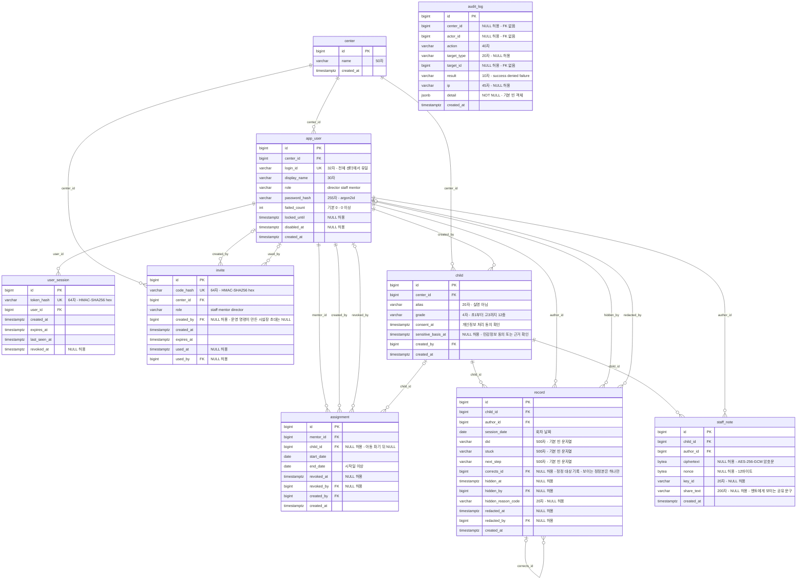

# 이어가기 ERD와 데이터 설계 (구현 기준)

> **용도**: 기획서 ❷ 5절(데이터 모델)이 실제 스키마에서 어떻게 구현됐는지 정리한 문서다. 팀장 검토와 개발계획서 업데이트본에 쓴다.
> **기준 시점**: 2026-10-11. 독립 보안 리뷰 조치 커밋 `cd57f76`(마이그레이션 0003)까지 반영했다. 정본은 `backend/app/models/*.py`와 `backend/alembic/versions/` 아래 마이그레이션 셋이다: `20261011_0001_initial_schema.py`(스키마), `..._0002_app_role_grants.py`(테이블 단위 권한), `..._0003_integrity_and_column_grants.py`(배정 겹침 배제 제약, 정정 부분 유니크 인덱스, `assignment.child_id` NULL 허용, UPDATE 컬럼 단위 권한). 이 문서와 다르면 코드가 맞다.
> **검증 방법**: 모델·마이그레이션을 읽고, 0003까지 적용된 로컬 PostgreSQL(`alembic_version = 0003`)에서 `\d`로 컬럼·인덱스·제약을, `information_schema`로 `ieogagi_app`의 테이블·컬럼 권한을 조회해 대조했다. ER 다이어그램은 Mermaid 11 파서로 구문을 검사했다.
> **함께 볼 문서**: 구조·요청 흐름은 [아키텍처.md](아키텍처.md), 보안 기법은 [보안설계.md](../보안설계.md).

## 1. ERD

도메인 테이블 9개다(마이그레이션 도구가 만드는 `alembic_version`은 따로 센다). 모든 PK는 `bigint` 시퀀스(SQLAlchemy `BigInteger` PK의 기본 동작)이고, 모든 시각 컬럼은 `timestamptz`이며 **DB 기본값 없이 앱의 `Clock`이 채운다**. 관계선에는 FK 컬럼 이름을 적었고, 모든 FK는 `ON DELETE` 지정이 없는 기본값(`NO ACTION`)이다. 관계선의 `|o`는 "없거나 하나"(NULL 허용 FK)를 뜻한다.

**`audit_log`에는 FK가 하나도 없다. 일부러 그렇게 했다.** 아동을 파기할 때 감사 이력이 함께 지워지거나(CASCADE), 이력 때문에 파기가 막히면(FK 위반) 안 되기 때문이다. 감사 행은 사람과 아동을 이름이 아니라 내부 ID(`actor_id`, `target_id`)로만 가리키고, 파기 뒤에는 이 ID가 가리키는 행이 없어진다. 센터도 같은 이유로 FK가 아니다(`models/audit.py` 설명).

**`assignment.child_id`는 NULL을 허용한다.** 아동을 파기하면 배정 행을 지우지 않고 `child_id`를 NULL로 끊고 회수 처리해서 남긴다(4.1절). 그래서 `assignment`와 `child`의 관계는 "배정은 아동이 없을 수도 있다"(`|o`)다.

**`record.corrects_id`에는 UNIQUE 제약이 없고, "보이는 행만" 유니크한 부분 인덱스가 있다.** 한 기록을 두 번 정정해서 정정 계보가 갈라지는 일을 DB가 막되(`uq_record_corrects_id_visible`, `WHERE hidden_at IS NULL`), 담당자가 숨긴 정정본은 계보를 막지 않는다. 숨긴 정정본이 하나 있는 원본에 새 정정본을 다시 만들 수 있고, 숨긴 정정본은 몇 개든 쌓일 수 있다. 그래서 관계는 "한 기록을 가리키는 정정본이 여럿일 수 있다"(`|o--o{`)이고 "보이는 것은 하나뿐"이라는 제한은 인덱스가 담당한다. 동시에 두 정정이 들어오면 하나는 유니크 위반으로 실패하고 서비스가 이를 409로 바꾼다(`services/records.py`). 정정본을 다시 정정하는 것은 가능하다(계보가 한 줄로 이어진다).

**관계선으로 그릴 수 없는 제약이 하나 더 있다.** `assignment`에는 같은 멘토·같은 아동의 살아 있는 배정 기간이 겹치지 못하게 하는 배제 제약 `ex_assignment_no_overlap`이 있다(2.3절).

### 1.1 FK 목록 (18개)

| 테이블.컬럼 | 참조 | NULL | 의미 |
|---|---|---|---|
| `app_user.center_id` | `center.id` | 불가 | 소속 센터 |
| `user_session.user_id` | `app_user.id` | 불가 | 세션 주인 |
| `invite.center_id` | `center.id` | 불가 | 초대받는 센터 |
| `invite.created_by` | `app_user.id` | 가능 | 발급자. 운영 명령 `ieogagi-add-center`가 만든 시설장 초대는 NULL |
| `invite.used_by` | `app_user.id` | 가능 | 코드로 가입한 계정(가입 직후 채움) |
| `child.center_id` | `center.id` | 불가 | 센터 격리 기준 |
| `child.created_by` | `app_user.id` | 불가 | 등록한 담당자·시설장 |
| `assignment.mentor_id` | `app_user.id` | 불가 | 배정받은 멘토 |
| `assignment.child_id` | `child.id` | **가능** | 대상 아동. 아동 파기 뒤 NULL(4.1절) |
| `assignment.created_by` | `app_user.id` | 불가 | 배정한 담당자·시설장 |
| `assignment.revoked_by` | `app_user.id` | 가능 | 회수한 담당자·시설장. 아동 파기로 회수된 배정은 파기한 시설장 |
| `record.child_id` | `child.id` | 불가 | 기록 대상 아동 |
| `record.author_id` | `app_user.id` | 불가 | 쓴 멘토 |
| `record.corrects_id` | `record.id` | 가능 | 정정하는 원본 기록 (보이는 정정본만 부분 유니크) |
| `record.hidden_by` | `app_user.id` | 가능 | 숨긴 담당자 |
| `record.redacted_by` | `app_user.id` | 가능 | 칸을 지운 담당자 |
| `staff_note.child_id` | `child.id` | 불가 | 메모 대상 아동 |
| `staff_note.author_id` | `app_user.id` | 불가 | 쓴 담당자 |

## 2. 제약 조건

제약 이름은 `models/base.py`의 명명 규칙(`pk_`, `uq_`, `fk_`, `ck_`, `ix_` 접두사)을 따른다. 배제 제약은 `ex_`, 부분 유니크 인덱스는 이름을 직접 붙였다.

### 2.1 CHECK

| 이름 | 테이블 | 식 | 목적 |
|---|---|---|---|
| `ck_app_user_role` | `app_user` | `role IN ('director', 'staff', 'mentor')` | 역할 3종 |
| `ck_app_user_failed_count` | `app_user` | `failed_count >= 0` | 실패 횟수 음수 방지 |
| `ck_invite_role` | `invite` | `role IN ('staff', 'mentor', 'director')` | 초대 가능한 역할. `director`는 운영 명령 전용 |
| `ck_assignment_period` | `assignment` | `start_date <= end_date` | 배정 기간 순서 |
| `ck_record_hidden_reason` | `record` | `hidden_reason_code IS NULL OR hidden_reason_code IN ('INAPPROPRIATE', 'WRONG_CHILD', 'DUPLICATE', 'SENSITIVE', 'OTHER')` | 숨김 사유 5종 |
| `ck_staff_note_cipher_fields` | `staff_note` | `(ciphertext, nonce, key_id)` 셋이 모두 NULL이거나 모두 값이 있음 | 암호문만 있고 nonce·키가 없는 행 방지. 공유 문구만 있는 메모는 허용 |
| `ck_audit_log_result` | `audit_log` | `result IN ('success', 'denied', 'failure')` | 결과 3종 |

### 2.2 UNIQUE와 부분 유니크 인덱스

| 이름 | 대상 | 이유 |
|---|---|---|
| `uq_app_user_login_id` | `app_user.login_id` | 로그인 ID는 **센터와 무관하게 전체에서 유일**. 비활성화한 계정의 ID도 다시 쓸 수 없다 |
| `uq_invite_code_hash` | `invite.code_hash` | 코드 조회 키 |
| `uq_user_session_token_hash` | `user_session.token_hash` | 세션 조회 키(요청마다 사용) |
| `uq_record_corrects_id_visible` | `record(corrects_id) WHERE hidden_at IS NULL` (유니크 **인덱스**, 0003) | 보이는 정정본이 하나만 있게 해서 정정 계보가 갈라지지 않게 한다. 숨긴 정정본(`hidden_at`이 있는 행)과 `corrects_id`가 NULL인 행은 제한이 없다. 0001의 `uq_record_corrects_id`(전체 UNIQUE 제약)는 0003이 지웠다 |

### 2.3 배제 제약 (EXCLUDE)

| 이름 | 테이블 | 정의 | 목적 |
|---|---|---|---|
| `ex_assignment_no_overlap` | `assignment` | `EXCLUDE USING gist (mentor_id WITH =, child_id WITH =, daterange(start_date, end_date, '[]') WITH &&) WHERE (revoked_at IS NULL)` (0003, `btree_gist` 확장 필요) | **같은 멘토·같은 아동의 살아 있는(미회수) 배정은 기간이 겹칠 수 없다.** 겹치는 배정이 둘 있으면 하나를 회수해도 다른 하나로 접근이 유지되므로, 회수가 항상 접근을 닫게 하려는 것이다 |

- 기간은 양 끝을 포함(`'[]'`)해서 비교한다. 같은 멘토에게 같은 아동의 연속 배정을 줄 때 앞 배정의 종료일과 뒤 배정의 시작일이 같으면 겹친 것이고, 하루 간격이 있으면 겹치지 않는다(로컬 DB에서 확인).
- **다른 멘토끼리는 같은 아동의 기간이 겹쳐도 된다**(인계 기간에 두 멘토가 함께 있을 수 있다). 회수된 배정은 제약 대상에서 빠진다. `child_id`가 NULL이 된(파기된) 배정은 `=` 비교가 참이 되지 않아 충돌하지 않고, 그 배정은 이미 회수 처리돼 있다.
- 위반하면 `IntegrityError`가 나고 서비스가 409로 바꾼다(`services/assignments.py`). 서비스 코드에서 먼저 겹침을 검사하는 방식은 동시 요청에서 경쟁조건이 생기므로 쓰지 않았다.
- `btree_gist`는 신뢰 확장이라 DB 소유자 역할(`ieogagi_owner`)이 마이그레이션 안에서 `CREATE EXTENSION IF NOT EXISTS`로 만든다. 테스트 DB는 소유자가 아니라서 슈퍼유저가 미리 만든다(`tests/conftest.py`).

### 2.4 인덱스

0001이 만드는 인덱스는 10개다. 0003이 더하는 것은 위 2.2절의 부분 유니크 인덱스와, 배제 제약이 자동으로 만드는 GiST 인덱스(이름 `ex_assignment_no_overlap`)다. PK·UNIQUE가 만드는 인덱스는 뺐다.

| 이름 | 컬럼 | 주 사용처(코드 기준) |
|---|---|---|
| `ix_app_user_center_id` | `app_user(center_id)` | 센터의 계정 목록 |
| `ix_user_session_user_id` | `user_session(user_id)` | 계정 비활성화 때 세션 일괄 폐기 |
| `ix_invite_center_id` | `invite(center_id)` | FK 보조 인덱스. 코드에서 이 컬럼으로 거르는 조회는 아직 없다 |
| `ix_child_center_id` | `child(center_id)` | 센터의 아동 목록, 센터 범위 확인 |
| `ix_assignment_mentor_child` | `assignment(mentor_id, child_id)` | **인가 쿼리** `find_active_assignment`, 멘토 홈 목록 |
| `ix_assignment_child_id` | `assignment(child_id)` | 아동별 배정 조회, 파기(`child` 삭제 때의 FK 확인과 연결 끊기) |
| `ix_record_child_session` | `record(child_id, session_date)` | 인계 카드(시작일 이전 기록), 기록 목록 정렬, 파기 |
| `ix_record_author_id` | `record(author_id)` | FK 보조 인덱스. 작성자만으로 거르는 조회는 없고 멘토 목록은 `child_id`와 함께 거른다 |
| `ix_staff_note_child_id` | `staff_note(child_id)` | 아동별 메모·공유 문구, 파기 |
| `ix_audit_log_center_created` | `audit_log(center_id, created_at)` | 감사 로그 검색(센터 범위 + 시간순) |

### 2.5 DB가 아니라 앱이 지키는 규칙

스키마만 봐서는 보장되지 않는 규칙이다. 검토할 때 "DB가 막아 주는 것"과 구분해서 본다.

| 규칙 | 지키는 곳 |
|---|---|
| `grade`는 `초1`~`초6`, `중1`~`중3`, `고1`~`고3` 12종 | `schemas/common.py`의 `Grade` (DB는 4자 문자열만 확인) |
| 배정 기간은 366일 이하 | `schemas/children.py` (같은 멘토·아동의 겹침은 DB가 막는다, 2.3절) |
| 날짜 입력(배정 시작·종료, 회차 날짜, 감사 로그 검색)은 2020-01-01 ~ 2100-12-31 | `schemas/common.py`의 `MIN_DATE`·`MAX_DATE` (DB는 `date` 범위만 확인) |
| 멘토는 같은 센터의 `mentor` 역할이고 비활성이 아님, 아동은 같은 센터 | `services/assignments.py` |
| 회차 날짜는 배정 기간 안이고 오늘(한국) 이전 | `services/records.py` |
| `did`·`stuck`·`next_step` 중 하나 이상 비어 있지 않음 | `schemas/records.py` |
| 정정은 본인 기록·배정 기간 안·숨김 아님·이미 정정되지 않음 | `services/records.py`. DB는 `corrects_id`가 **같은 아동의 행**을 가리키는지 확인하지 않는다 |
| `hidden_at`·`hidden_by`·`hidden_reason_code`가 함께 채워짐 | `services/record_moderation.py` (DB는 사유가 NULL인 숨김 행을 막지 않는다) |
| `child_id`가 NULL인 배정은 반드시 회수 처리돼 있음 | `services/children.py`의 `destroy_child` (DB는 `child_id`가 NULL이고 `revoked_at`도 NULL인 행을 막지 않는다) |
| 메모는 원문(`body`)이나 공유 문구 중 하나 이상. 원문은 민감정보 확인이 된 아동에게만 | `schemas/records.py`, `services/notes.py` |
| 비밀번호 10~128자·2종류 이상 | `security/passwords.py` |
| `app_user.role`은 가입에 쓴 `invite.role`과 같음 | `services/auth_service.py` (`role`은 앱 역할이 UPDATE할 수 없는 컬럼이라 가입 뒤에는 바뀌지 않는다, 3절) |

## 3. DB 역할과 권한

DB 역할은 둘이다. 마이그레이션·운영 명령은 `ieogagi_owner`, 실행 중인 앱은 `ieogagi_app`으로 접속한다. 스키마 소유자는 `ieogagi_owner`라서 모든 테이블에 대해 전체 권한(DDL 포함)을 가진다. 앱 역할 권한은 두 단계로 정해진다.

- `0002_app_role_grants`: `REVOKE ALL ... FROM PUBLIC` 후 테이블 단위로 SELECT·INSERT·UPDATE·DELETE를 필요한 만큼 부여.
- `0003_integrity_and_column_grants`: 일곱 테이블(`app_user`, `user_session`, `invite`, `child`, `assignment`, `record`, `staff_note`)의 **테이블 단위 UPDATE를 회수**하고, 코드가 실제로 바꾸는 컬럼에만 **컬럼 단위 UPDATE**를 다시 부여. `downgrade`는 테이블 단위 UPDATE를 되돌린다.

아래 표의 앱 역할 권한은 로컬 DB에서 `information_schema.role_table_grants`·`column_privileges`로 조회한 값과 일치한다.

| 테이블 | `ieogagi_owner` | `ieogagi_app` 테이블 단위 | `ieogagi_app` UPDATE 가능 컬럼 (컬럼 단위) | 앱 코드의 실제 사용 |
|---|---|---|---|---|
| `center` | 전체 | SELECT | – | 조회만. 센터 추가는 운영 명령(소유자) |
| `app_user` | 전체 | SELECT, INSERT | `failed_count`, `locked_until`, `disabled_at`, `password_hash` | 가입(INSERT), 로그인 시도 확보·성공 초기화·재해시, 비활성화(UPDATE). 삭제하지 않는다 |
| `user_session` | 전체 | SELECT, INSERT | `last_seen_at`, `revoked_at` | 로그인(INSERT), 갱신·폐기(UPDATE). 삭제하지 않는다 |
| `invite` | 전체 | SELECT, INSERT | `used_at`, `used_by` | 발급(INSERT), 소비(UPDATE). 삭제하지 않는다 |
| `child` | 전체 | SELECT, INSERT, DELETE | `sensitive_basis_at` | 등록, 민감정보 확인 시각(UPDATE), 파기(DELETE) |
| `assignment` | 전체 | SELECT, INSERT | `revoked_at`, `revoked_by`, `child_id` | 생성, 회수(UPDATE), 파기 때 `child_id`를 NULL로 끊고 회수 처리(UPDATE). DELETE는 0004에서 회수 |
| `record` | 전체 | SELECT, INSERT, DELETE | `did`, `stuck`, `next_step`, `hidden_at`, `hidden_by`, `hidden_reason_code`, `redacted_at`, `redacted_by` | 작성·정정(INSERT), 숨김·칸 지우기(UPDATE), 파기(DELETE) |
| `staff_note` | 전체 | SELECT, INSERT, DELETE | `ciphertext`, `nonce`, `key_id` | 작성(INSERT 후 같은 트랜잭션에서 암호문 UPDATE), 파기(DELETE) |
| `audit_log` | 전체 | SELECT, INSERT | **–** (UPDATE·DELETE 없음) | 기록(INSERT)과 검색(SELECT)만. 수정·삭제 권한이 없다 |
| `alembic_version` | 전체 | – | – | 마이그레이션 도구 전용 |

- **앱 역할이 UPDATE할 수 없는 컬럼 = 신원·소유 컬럼.** 예: `app_user`의 `role`·`center_id`·`login_id`·`display_name`·`created_at`, `user_session`의 `token_hash`·`user_id`·`expires_at`(절대 만료 시각을 늘릴 수 없다), `invite`의 `code_hash`·`center_id`·`role`·`expires_at`, `child`의 `center_id`·`alias`·`grade`·`consent_at`·`created_by`, `assignment`의 `mentor_id`·`start_date`·`end_date`·`created_by`, `record`의 `child_id`·`author_id`·`session_date`·`corrects_id`·`created_at`, `staff_note`의 `child_id`·`author_id`·`share_text`. 앱 코드에 버그가 있어도 이 컬럼은 권한 오류가 난다(`test_app_role_cannot_update_identity_columns`가 `role`·`center_id`·`author_id`·`end_date` 수정을 확인한다).
- **새 UPDATE 경로를 만들면 마이그레이션에 컬럼 GRANT를 추가해야 한다.** 없으면 권한 오류로 실패한다(보안 쪽으로 실패하는 방향).
- `SELECT ... FOR SHARE`(기록 작성·정정 때 배정 행 잠금)는 대상 테이블의 UPDATE 권한이 한 컬럼이라도 있어야 하는데, `assignment`에 컬럼 UPDATE 권한이 있어 허용된다(`audit_log`에 같은 문장을 하면 권한 오류가 나는 것을 확인했다).
- 시퀀스는 `USAGE`만 부여하고(PK 채번), 스키마에는 `USAGE`만 부여한다. `TRUNCATE`·DDL은 앱 역할에 없다.
- 데이터베이스 `ieogagi`에 대한 PUBLIC의 CONNECT는 회수하고 두 역할에만 부여한다(`deploy/db-init/01-roles.sh`, 개발용은 `ieogagi-db-roles`).
- 소유자 역할은 `migrate`(스키마 변경), `admin`(센터 추가), 개발용 시드(`ieogagi-seed`)에서만 쓴다. 실행 중인 `app` 컨테이너에는 소유자 URL 비밀이 마운트되지 않는다.
- 테스트는 앱 역할로 `SET ROLE ieogagi_app` 한 뒤 실제 마이그레이션이 만든 스키마에서 돌아서, 권한 설정도 함께 검증한다. `audit_log` UPDATE·DELETE가 권한 오류가 되는 것(`test_app_role_cannot_modify_audit_log`)과 신원 컬럼 UPDATE가 권한 오류가 되는 것을 확인하는 테스트가 있다.

## 4. 데이터 수명주기

### 4.1 아동 파기: 기록은 지우고, 배정은 아동과의 연결만 끊는다

`DELETE /api/children/{id}`는 **시설장만** 호출할 수 있다(`DirectorChildAccess`). 한 트랜잭션에서 아래를 순서대로 실행하고, 같은 트랜잭션에 `child.destroy` 감사 행(`detail: {records, notes, assignments}` 건수)을 넣는다.

1. `DELETE FROM record WHERE child_id = ?` (`corrects_id` 자기 참조는 한 문장 안에서 처리된다. FK가 `NO ACTION`이라 문장 끝에 확인한다)
2. `DELETE FROM staff_note WHERE child_id = ?`
3. `UPDATE assignment SET child_id = NULL, revoked_at = COALESCE(revoked_at, 지금), revoked_by = COALESCE(revoked_by, 시설장) WHERE child_id = ?` — 이 문장이 쓰는 컬럼 셋(`child_id`, `revoked_at`, `revoked_by`)이 앱 역할의 `assignment` UPDATE 컬럼 목록과 정확히 같다.
4. `DELETE FROM child WHERE id = ?` (3번에서 참조가 없어진 뒤라 FK에 걸리지 않는다)

| 구분 | 대상 | 파기 후 |
|---|---|---|
| 지워짐 | 그 아동의 `record` 전부(숨김·정정본·정정 전 원본 포함) | 없음 |
| 지워짐 | 그 아동의 `staff_note` 전부(암호문과 공유 문구) | 없음 |
| 지워짐 | `child` 행(별칭·학년·동의 시각) | 없음 |
| **남음(연결 끊김)** | 그 아동의 `assignment` 전부 | `child_id`가 NULL, `revoked_at`·`revoked_by`가 채워진 회수 상태. 멘토·기간·생성자는 그대로. 아동을 알아낼 정보는 행에 없다 |
| **남음** | `audit_log` 전부(그 아동에 대한 열람·작성·배정·거부 이력 포함) | 내부 ID만 담고 있으므로 보관 기준대로 둔다. 새로 `child.destroy`가 추가된다 |
| 남음 | `app_user`, `user_session`, `invite`, `center` | 멘토 계정과 세션은 그대로 |
| 남음 | DB 백업본 | 백업 보관 주기(14일, `deploy/README.md`)가 지나 덮어써질 때 사라진다 |

- **왜 배정을 지우지 않나.** 담당자 화면은 "활성인데 배정이 모두 끝난 멘토 계정"(`assignment_ended`)을 표시해서 계정 정리를 돕는다. 이 계산은 `assignment`에 그 멘토의 행이 있었는지(`mentor_id`)와 살아 있는 배정이 남았는지를 본다. 아동 파기 때 배정까지 지우면 "배정이 있었다"는 흔적이 사라져 멘토 계정이 정리 대상으로 뜨지 않는다. 연결을 끊고 회수 처리하면 그 신호가 남는다(회귀 테스트 `test_destroying_child_keeps_assignment_ended_signal`).
- 연결이 끊긴 배정은 `child`와의 JOIN을 쓰는 목록(`GET /api/assignments`, `GET /api/me/assignments`)과 회수 대상 조회에서 자연히 빠진다. 접근 판정(`find_active_assignment`)도 `child`와 JOIN하고 회수 상태라서 어떤 접근도 열지 못한다.
- 배제 제약(2.3절)은 회수된 행과 `child_id`가 NULL인 행을 대상에서 빼므로, 이 행들이 쌓여도 새 배정을 막지 않는다.

### 4.2 세션: 폐기와 삭제

- 발급: 로그인 성공 때 `user_session` 행을 만든다. `expires_at = 발급 시각 + 절대 8시간`, `last_seen_at = 발급 시각`. 쿠키에는 무작위 토큰이 가고 DB에는 HMAC만 저장한다. 로그인 요청에 이전 세션 쿠키가 실려 있었으면 그 토큰의 행은 먼저 폐기한다.
- 유효 조건(요청마다, SQL 한 문장): `revoked_at IS NULL ∧ expires_at > 지금 ∧ last_seen_at > 지금 - 유휴 10분`. 유효하면 같은 문장에서 `last_seen_at`을 갱신한다.
- 폐기: 로그아웃은 그 토큰의 `revoked_at`만 채운다. 로그아웃 API는 로그인 없이 호출되며 세션이 이미 만료·폐기돼 있어도 204로 끝나고 쿠키를 지운다. 계정 비활성화는 그 사용자의 **모든 세션**에 `revoked_at`을 채운다. 폐기는 UPDATE이고 행은 남는다.
- 삭제: 없다. 앱 역할에 DELETE 권한이 없고, 만료·폐기된 행을 정리하는 작업도 없다(소유자 역할로 수동 정리).
- 앱 역할은 `expires_at`을 UPDATE할 수 없다. 세션 만료 시각은 발급 때 한 번 정해지면 앱이 늘릴 수 없다.

### 4.3 계정과 로그인 시도

- 비활성화는 `disabled_at`을 채우는 것이다(`WHERE disabled_at IS NULL`인 행만, 이미 비활성이면 409). 계정 행은 지우지 않으므로 `login_id`는 계속 점유된다.
- 로그인 시도는 **비밀번호를 확인하기 전에** 한 문장으로 확보한다(`_reserve_attempt`).
  `UPDATE app_user SET failed_count = CASE WHEN failed_count + 1 >= 5 THEN 0 ELSE failed_count + 1 END, locked_until = CASE WHEN failed_count + 1 >= 5 THEN 지금 + 15분 ELSE NULL END WHERE id = ? AND disabled_at IS NULL AND (locked_until IS NULL OR locked_until <= 지금) RETURNING id` 를 실행하고 바로 commit한다.
  - 비활성이거나 잠긴 계정은 WHERE에 걸려 행이 잡히지 않는다. 이때는 비밀번호를 확인하지 않고 거부한다. 그래서 동시 요청이 몰려도 비밀번호 확인은 한 구간에 5번을 넘지 못한다.
  - 5번째 시도에서 잠금이 걸리고 카운터는 0으로 돌아간다. 그 5번째 시도가 맞는 비밀번호면 통과하고 잠금도 풀린다.
  - 비밀번호가 맞으면 `failed_count = 0`, `locked_until = NULL`로 되돌린다(저장된 해시의 매개변수가 오래됐으면 `password_hash`도 새로 해시해 갱신).
- 비활성·잠금·없는 계정·틀린 비밀번호는 응답 문구가 같고, 확인하지 않는 경우에도 더미 해시 검증으로 처리 시간을 맞춘다.

### 4.4 초대 코드는 한 번만 쓴다

1. 발급(`POST /api/invites`): 코드를 한 번만 응답으로 보여 주고 DB에는 HMAC만 저장한다. `expires_at = 발급 + 72시간`, `created_by = 발급자`.
2. 확인(`POST /api/auth/invites/verify`): 읽기 전용이다. 소비하지 않는다.
3. 소비(`POST /api/auth/signup`): `UPDATE invite SET used_at = 지금 WHERE code_hash = ? AND used_at IS NULL AND expires_at > 지금 RETURNING ...` 한 문장. 동시에 두 요청이 와도 하나만 행을 받는다. 이어서 계정을 만들고 `used_by`를 채운다. 앱 역할이 `invite`에서 UPDATE할 수 있는 컬럼은 `used_at`·`used_by` 둘뿐이라서 `expires_at`이나 `role`은 바꿀 수 없다.
4. 로그인 ID가 겹쳐 계정 생성에 실패하면 트랜잭션을 롤백해서 `used_at`도 되돌아가고, 코드는 다시 쓸 수 있다.
5. 사용·만료된 초대 행은 남는다.

### 4.5 기록: 덧붙이기, 숨김, 지우기

| 동작 | 누가 | DB에서 일어나는 일 | 멘토 화면에서 |
|---|---|---|---|
| 작성 | 멘토(배정 기간 안) | `record` INSERT (`corrects_id` NULL). 배정 행에 공유 잠금(`FOR SHARE`)을 걸고 확인한다 | 내 기록에 보임 |
| 정정 | 멘토(본인 기록) | **새 `record` INSERT** (`corrects_id` = 원본, 같은 `session_date`). 원본은 그대로. 보이는 정정본이 이미 있으면 409(동시 요청은 유니크 인덱스 위반이 409로 바뀜) | 원본은 사라지고 정정본만 보임(원본은 "정정됨"이라서 제외) |
| 숨김 | 담당자·시설장 | 해당 행 UPDATE: `hidden_at`, `hidden_by`, `hidden_reason_code`. 이미 숨긴 행은 409. **되돌리는 API는 없다** | 목록과 인계 카드에서 제외. **정정본을 숨기면** 그 정정본은 원본을 대체하지 않으므로 원본이 다시 보이고 다시 정정할 수 있다 |
| 칸 지우기 | 담당자·시설장 | 선택한 칸(`did`·`stuck`·`next_step`)을 **빈 문자열**로 UPDATE하고 `redacted_at`·`redacted_by`를 채운다 | 빈 칸으로 보임. 어느 칸이었는지는 감사 `record.redact`의 detail |
| 파기 | 시설장 | 4.1절 | – |

멘토가 보는 기록의 집합(`services/record_queries.py`):

- **"유효 기록"** = 숨기지 않았고(`hidden_at IS NULL`), 숨기지 않은 정정본이 그 기록을 가리키고 있지 않은 것. 멘토 쿼리는 항상 이 필터를 건다.
- **인계 카드**: 같은 아동의 유효 기록 중 `session_date < 내 배정 시작일`인 것 가운데 최근 4개. 회차 번호는 저장하지 않고 조회할 때 `(session_date, id)` 순서로 `row_number()`를 계산한다. 여기에 담당자 메모의 `share_text` 최대 10개가 붙는다.
- **내 기록**: `author_id = 나`, `session_date`가 내 배정 기간 안, 유효 기록. 최대 500행.
- 담당자·시설장은 같은 센터 아동의 전체 기록을 최대 500행 본다. 숨김·지움·대체(`superseded`) 여부가 필드로 함께 내려간다.

**append-only는 코드 경로와 컬럼 권한으로 지킨다.** 앱 역할은 `record`의 작성자·아동·회차 날짜·정정 대상·작성 시각을 UPDATE할 수 없다(3절). UPDATE할 수 있는 건 세 칸(칸 지우기용)과 숨김·지우기 이력 컬럼뿐이고, 실제 코드에서 `record`를 UPDATE하는 곳은 숨김·지우기 두 곳, DELETE하는 곳은 아동 파기 한 곳이다. 다만 세 칸의 내용은 권한상 바꿀 수 있고 DELETE도 열려 있어서, `audit_log`처럼 DB 권한만으로 완전히 막지는 못한다(6절).

### 4.6 담당자 메모

- 작성: `staff_note` INSERT(`flush`로 `id` 확보) → 그 `id`와 `child_id`를 AAD로 묶어 AES-256-GCM 암호화 → 같은 트랜잭션에서 `ciphertext`·`nonce`·`key_id`를 UPDATE. 원문 없이 공유 문구만 있는 메모는 세 컬럼이 모두 NULL이다.
- 원문 열람(`GET /api/notes/{id}`)은 담당자·시설장만 가능하고 `note.view`가 감사 로그에 남는다. 다른 행으로 옮긴 암호문은 AAD가 달라 복호화에 실패한다.
- 수정·삭제 API는 없고, 앱 역할은 `share_text`·`child_id`·`author_id`를 UPDATE할 수 없다. 지워지는 경우는 아동 파기뿐이다.
- 목록은 아동별로 최대 200개를 최신순으로 준다.

### 4.7 감사 로그

- INSERT만 한다(권한상 UPDATE·DELETE 불가). 보관은 최소 3년, 정리는 소유자 역할로 DB 관리자가 한다(`deploy/README.md` 6절).
- 같은 트랜잭션에 쓰는 `stage`(변경과 함께 확정)와 거부·실패 흔적용 `write_now`가 있다. **`write_now(db, ...)`는 요청 Session에서 미확정 변경을 롤백한 뒤 같은 연결에서 감사 행만 insert하고 commit한다.** 별도 연결을 잡지 않고, 거부·실패한 요청의 변경은 남지 않는다. 호출하는 쪽은 곧바로 예외를 던진다(`deny()`는 `Forbidden`을 돌려주고 호출한 곳이 `raise`한다). 자세한 흐름은 [아키텍처.md](아키텍처.md) 3.6절.
- **센터가 없는 행**: 존재하지 않는 계정으로 로그인 시도하거나 잘못된 초대 코드로 가입을 시도하면 `actor_id`와 `center_id`가 NULL이다. 감사 로그 검색 API는 `center_id = 요청자 센터`로 거르므로 이런 행은 화면에 나오지 않고 DB에서만 보인다.
- 아동 실명 대신 내부 ID만 기록한다.

#### action 21종과 detail

| action | result | target_type | detail 키 |
|---|---|---|---|
| `auth.login` | success / failure / denied | `user` (없는 계정은 NULL) | 실패·거부: `reason` (`unknown_account`·`bad_password`는 failure, `disabled`·`locked`는 denied). 성공은 비어 있음 |
| `auth.logout` | success | `user` | – (세션이 이미 유효하지 않았다면 기록하지 않음) |
| `auth.signup` | success / failure | `user` (실패는 NULL) | `role`, `invite_id` / 실패: `reason: invalid_invite` |
| `invite.create` | success | `invite` | `role` |
| `user.disable` | success | `user` | `revoked_sessions` |
| `child.create` | success | `child` | `sensitive_basis` |
| `child.sensitive_basis` | success | `child` | – |
| `child.destroy` | success | `child` | `records`, `notes` 삭제 건수, `assignments` 연결을 끊은 건수 |
| `assignment.create` | success | `assignment` | `mentor_id`, `child_id`, `period` |
| `assignment.revoke` | success | `assignment` | `mentor_id` |
| `record.view` | success | `child` | `count` |
| `record.create` | success | `record` | `child_id`, `sensitive_confirmed`(범주 목록) |
| `record.correct` | success | `record`(정정본) | `corrects_id`, `sensitive_confirmed` |
| `record.sensitive_prompt` | success | `child` | `categories` |
| `record.hide` | success | `record` | `reason_code` |
| `record.redact` | success | `record` | `fields` |
| `handover.view` | success | `child` | `records` 건수 |
| `note.create` | success | `note` | `child_id`, `has_body` |
| `note.view` | success | `note` | `child_id` |
| `audit.view` | success | – | `offset` |
| `access.denied` | denied | `child`·`record`·`note`·`user`·`invite`·`assignment` (역할 불허만으로 거부된 경우 NULL) | `attempted`(라우트 템플릿), `reason`(`role`·`not_assigned`·`before_start`·`after_end`·`revoked`·`other_center_or_missing`·`not_permitted_target`·`mentor_or_child_not_in_center`·`not_own_record_in_period`), 배정 관련 거부는 `period`·`assignment_id`, 초대 거부는 `invite_role`, 배정 생성 거부는 `mentor_id`·`child_id` |

## 5. 기획서 5절 대비 차이 (컬럼 단위)

기획서 ❷ 5절 표와 실제 스키마를 대조한 결과다. 아키텍처 수준의 차이(API 수, 배포 등)는 [아키텍처.md](아키텍처.md) 8절에 있다.

| 테이블 | 기획서 컬럼 | 구현 | 차이 | 이유 |
|---|---|---|---|---|
| `center` | id, name | id, name, **created_at** | 생성 시각 추가 | 모든 테이블에 생성 시각을 둔다 |
| `user` → `app_user` | id, center_id, role(시설장/담당자/멘토), password_hash, failed_count, locked_until, disabled_at | id, center_id, **login_id**, **display_name**, role, password_hash, failed_count, locked_until, disabled_at, **created_at** | **테이블명 변경**. 로그인 ID(전체 유일)·표시 이름·생성 시각 추가. 역할 값은 한글이 아니라 영문 코드 `director`·`staff`·`mentor`이고 CHECK로 제한. 앱 역할은 `failed_count`·`locked_until`·`disabled_at`·`password_hash`만 UPDATE 가능(`role`·`center_id`는 불가) | `user`는 PostgreSQL 예약어. 가입·로그인에 쓸 식별자와 화면에 보일 이름이 필요. 권한이 바뀌는 컬럼을 앱이 못 바꾸게 함 |
| `session` → `user_session` | token_hash, user_id, expires_at, last_seen_at, revoked_at | **id**, token_hash, user_id, **created_at**, expires_at, last_seen_at, revoked_at | **테이블명 변경**. 대리 키 `id`와 `created_at` 추가. `token_hash`는 단순 해시가 아니라 서버 키를 쓴 **HMAC-SHA256**(용도 접두사 `session`) hex 64자. 앱 역할은 `last_seen_at`·`revoked_at`만 UPDATE 가능 | `session`은 예약어는 아니지만 `app_user`와 짝을 맞추고 DB 세션과 구분(코드에 이유 주석 없음, 추정). HMAC은 DB가 유출돼도 쓸 수 있는 토큰이 없게 하려는 것(보안설계 S13). 절대 만료 시각을 앱이 못 늘리게 함 |
| `invite` | code_hash, center_id, role, expires_at, used_at | **id**, code_hash, center_id, role, **created_by**, **created_at**, expires_at, used_at, **used_by** | 발급자·발급 시각·사용자 추가. `created_by`는 NULL 허용. `role` CHECK에 `director` 포함. `code_hash`는 HMAC(용도 접두사 `invite`). 앱 역할은 `used_at`·`used_by`만 UPDATE 가능 | 누가 발급하고 누가 썼는지 추적. 시설장 초대는 운영 명령이 만들어서 발급자가 없다 |
| `child` | id, center_id, alias, grade, consent_at, sensitive_basis_at | id, center_id, alias, grade, consent_at, sensitive_basis_at, **created_by**, **created_at** | 등록자·등록 시각 추가. 앱 역할은 `sensitive_basis_at`만 UPDATE 가능 | 등록 책임 추적. `sensitive_basis_at`은 등록 뒤에 따로 기록할 수 있어 NULL 허용 |
| `assignment` | mentor_id, child_id, start_date, end_date, revoked_at, created_by | **id**, mentor_id, **child_id(NULL 허용)**, start_date, end_date, revoked_at, **revoked_by**, created_by, **created_at** | 회수자·생성 시각 추가. CHECK `start_date <= end_date`, 복합 인덱스 `(mentor_id, child_id)`. **배제 제약 `ex_assignment_no_overlap`**(같은 멘토·아동의 미회수 배정은 기간 겹침 불가). **`child_id`가 NULL 가능**: 아동 파기 때 행을 지우지 않고 연결을 끊고 회수 처리. 앱 역할은 `revoked_at`·`revoked_by`·`child_id`만 UPDATE 가능(기간·멘토는 불가) | 회수 책임 추적. 인가 쿼리를 받치는 인덱스. 겹치는 배정이 회수의 효과를 가리는 문제를 DB가 막음. 파기 후에도 "배정이 끝난 계정" 신호를 남겨 계정 정리를 돕는다(기획서는 "assignment 행 삭제") |
| `record` | child_id, author_id, did, stuck, **next**, corrects_id, hidden_at, hidden_reason_code, created_at | id, child_id, author_id, **session_date**, did, stuck, **next_step**, corrects_id, hidden_at, **hidden_by**, hidden_reason_code, **redacted_at**, **redacted_by**, created_at | `next` → **`next_step`**. 회차 날짜 `session_date`(NOT NULL), 숨긴 사람, 지우기 시각·담당자 추가. `corrects_id`는 UNIQUE가 아니라 **"보이는 행만" 부분 유니크 인덱스**, 사유 CHECK 5종. 세 칸은 NOT NULL 기본 빈 문자열. 앱 역할은 세 칸과 `hidden_*`·`redacted_*`만 UPDATE 가능 | `next`는 Python 내장 이름이라 피한 것으로 보인다(코드에 이유 없음, 추정). 인계 카드가 "배정 시작 전" 기록을 회차 날짜로 가르므로 `session_date` 필요(작성 시각 `created_at`과 다름). 지우기를 숨김과 별개 상태로 남기기 위해 `redacted_*` 추가. 숨긴 정정본이 원본을 영구히 가리지 않도록 부분 인덱스 |
| `staff_note` | child_id, ciphertext, nonce, key_id, share_text | **id**, child_id, **author_id**, ciphertext, nonce, key_id, share_text, **created_at** | 작성자·작성 시각 추가. 암호 컬럼 셋은 NULL 허용(함께 NULL이거나 함께 값, CHECK). `share_text` 200자. 앱 역할은 `ciphertext`·`nonce`·`key_id`만 UPDATE 가능 | 공유 문구만 있는 메모를 허용해야 한다(API: 원문과 공유 문구 중 하나 이상). 메모 ID가 AAD에 쓰이므로 `id` 필요 |
| `audit_log` | center_id, actor_id, action, target_type, target_id, result, ip, detail, created_at | **id**, center_id, actor_id, action, target_type, target_id, result, ip, detail, created_at | 컬럼은 같고 `id` 추가. `center_id`·`actor_id` NULL 허용, `detail`은 JSONB NOT NULL, `result` CHECK 3종, 인덱스 `(center_id, created_at)`. FK 없음 | 로그인 전 이벤트(없는 계정 시도)는 행위자·센터가 없다. 파기가 감사 이력에 영향을 주지 않게 FK를 두지 않음 |
| (기획서에 없음) | – | `alembic_version` | 마이그레이션 버전 관리용 테이블 1개 추가 | Alembic이 만든다. 앱 역할은 접근 권한이 없다 |

공통 차이는 다섯 가지다.

1. **PK 모두 `bigint` 대리 키**다. 기획서 표는 `user.id`·`child.id` 외에 PK를 적지 않았는데, 구현은 모든 테이블에 `id`가 있다.
2. **시각 컬럼은 전부 `timestamptz`이고 DB 기본값이 없다.** 앱이 `Clock`으로 채우므로 테스트가 시간을 고정할 수 있다.
3. **앱 역할의 UPDATE는 컬럼 단위다.** 기획서는 앱 계정이 `audit_log`에 INSERT·SELECT만 한다는 것까지만 정했고, 나머지 테이블의 UPDATE 범위는 구현에서 좁혔다(0003). 신원·소유 컬럼(`role`, `center_id`, `author_id`, 배정 기간 등)은 앱이 바꿀 수 없다.
4. **경쟁조건 처리의 근거가 되는 구조가 늘었다.** 기획서가 "원자적 UPDATE"로 쓰겠다고 한 것은 초대 코드 소비뿐이다(`used_at IS NULL` 조건부 UPDATE로 구현). 구현은 이에 더해 로그인 시도 확보(조건부 UPDATE), 같은 멘토·아동 배정 겹침(배제 제약), 같은 기록의 동시 정정(부분 유니크 인덱스), 작성·정정과 회수의 엇갈림(`FOR SHARE`)을 DB 쪽 구조로 막는다.
5. **아동 파기가 `assignment`를 삭제하지 않는다.** 기획서의 "record·staff_note·assignment·child 행을 삭제"와 다르다(4.1절).

## 6. 확인된 한계

| 항목 | 내용 |
|---|---|
| 앱 역할의 `record` 변경 권한 | 4.5절. DELETE가 열려 있고, 세 칸의 내용은 권한상 UPDATE할 수 있다. 코드 경로로만 제한된다 |
| 정리 작업 없음 | 만료·폐기 세션, 사용·만료 초대, 3년이 지난 감사 행, 연결이 끊긴 배정 행을 지우는 코드가 없다(앱 역할 DELETE 권한도 대부분 없음) |
| 센터 없는 감사 행 | 4.7절. 화면(API)에서는 안 보인다 |
| 새 UPDATE 경로·새 테이블 권한 | UPDATE는 컬럼 단위라서 새 UPDATE 경로에는 컬럼 GRANT를 추가해야 한다. `0002`·`0003`은 기존 테이블에만 GRANT하므로 새 테이블도 GRANT를 명시해야 앱이 접근한다 |
| 로그인 ID 재사용 불가 | 비활성화한 계정의 `login_id`도 점유된 채 남는다 |
| DB가 막지 않는 일관성 | 2.5절 표. 예: `corrects_id`가 같은 아동의 행인지, `child_id`가 NULL인 배정이 회수 상태인지, 숨김 3컬럼이 함께 채워지는지 |
| 0003의 배포 컨테이너 실행 | 로컬 PostgreSQL에서만 적용·확인했다. 소유자 역할이 마이그레이션 안에서 `btree_gist`를 만드는 경로를 `migrate` 컨테이너에서 돌려 본 적은 없다 |
| 공유 잠금 동시성 | 해소(10/17): 기록 작성이 건 배정 행 `FOR SHARE`가 동시 회수를 실제로 기다리게 하는지 `tests/test_concurrency_revoke.py` 2개가 확인한다. 파기와 동시 쓰기의 잠금 순서(기록 → 배정 → 아동)는 `test_concurrency_destroy.py`·`test_concurrency_lock_order.py`가 확인한다 |
