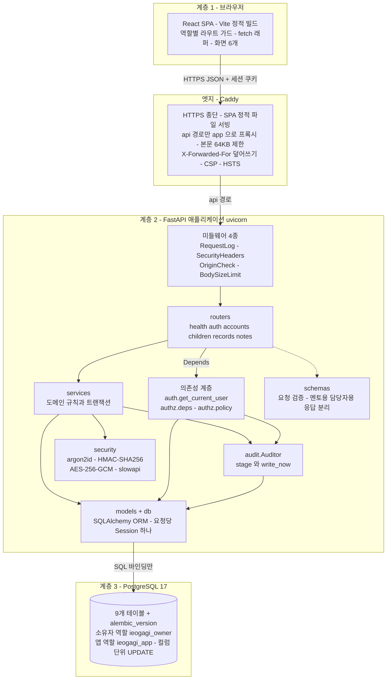
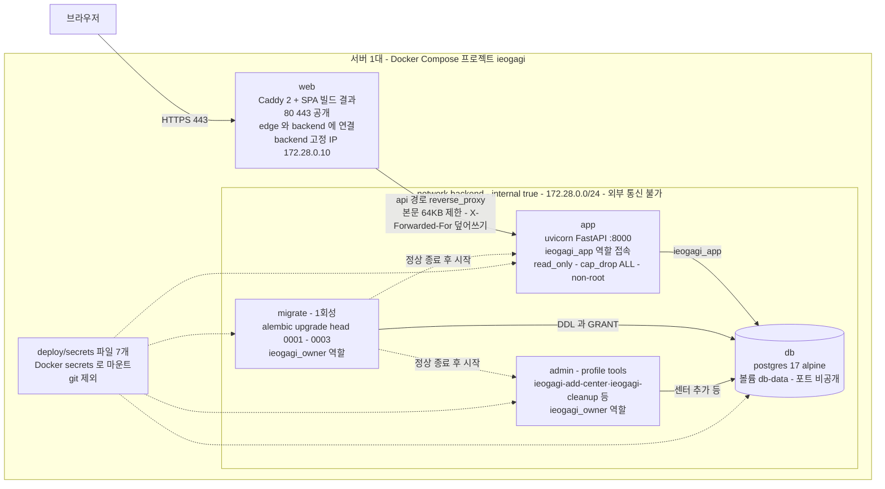
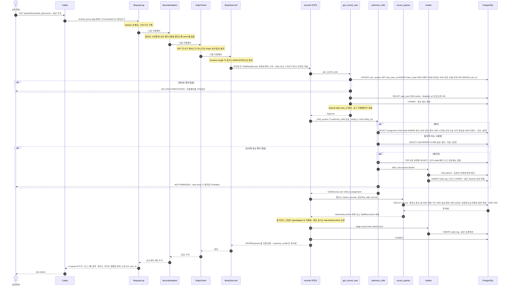
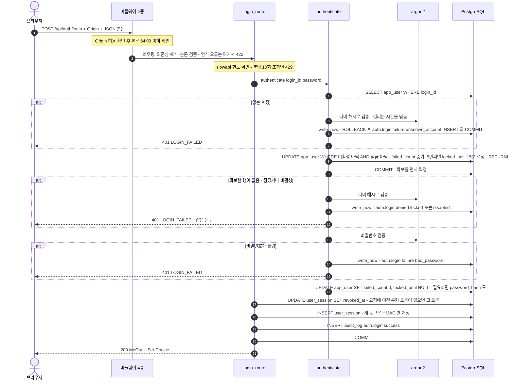

# 이어가기 아키텍처 (구현 기준)

> **용도**: 기획서 ❷ 4절(시스템 아키텍처)·5절(데이터 모델과 API)·7절(개발보안 설계)이 **실제 코드에서 어떻게 구현됐는지**를 한곳에 정리한 설계 문서다. 팀장 검토와 개발계획서 업데이트본 작성에 쓴다.
> **기준 시점**: 2026-10-11 저장소 상태. 독립 보안 리뷰 조치 커밋 `cd57f76`(마이그레이션 0003 포함)까지 반영했다. 코드가 정본이고, 이 문서와 코드가 다르면 코드가 맞다.
> **검증 방법**: `backend/app/**`·`alembic/versions/*`·`deploy/*`·`frontend/src/**`를 읽어 대조했다. `create_app()`으로 앱을 만들어 미들웨어 스택의 실제 순서를 출력했고, TestClient로 500 응답의 헤더, 413 응답, 401·422 판정 순서를 확인했고, slowapi 데코레이터의 소스로 한도 확인 위치를 확인했다. 로컬 PostgreSQL(마이그레이션 0003 적용 상태)에서 인덱스·제약·권한을 조회했다. 이 문서의 Mermaid 다이어그램 4개는 Mermaid 11 파서로 구문을 검사했다. `docs/api/openapi.json`의 경로 수(27개)도 세어 봤다. `docker compose`는 이번에 다시 실행하지 않았고, 0003 마이그레이션을 배포 컨테이너에서 돌려 본 적도 없다(2026-10-11 로컬 Docker 검증은 0003 이전 상태이고 결과는 `deploy/README.md`에 있다).
> **함께 볼 문서**: 테이블·권한은 [ERD.md](ERD.md), API 계약은 [API_설계.md](../API_설계.md), 보안 기법 25개는 [보안설계.md](../보안설계.md).

## 1. 3계층 구조

브라우저(React SPA) → Caddy → FastAPI → PostgreSQL. 런타임에 외부 API·LLM·파일 업로드를 쓰지 않는다. 기획서 [그림 1]의 3계층에 엣지(Caddy)를 따로 그렸다.



| 계층 | 구성 | 책임 | 일부러 하지 않는 일 |
|---|---|---|---|
| 브라우저 | React 19, react-router-dom 7, Vite 8 (UI 라이브러리 없이 일반 CSS) | 화면 6개(라우트 8개 + 404), 역할별 라우트 가드, 401이면 로그인 화면으로 이동, 입력 안내와 저장 전 확인창 | 토큰을 읽거나 저장하지 않는다(세션은 HttpOnly 쿠키). 권한 판정은 서버가 하고 가드는 화면 편의일 뿐이다 |
| 엣지 | Caddy 2 (`deploy/Caddyfile`) | HTTPS, SPA 정적 파일(`try_files {path} /index.html`), `/api/*`만 `app:8000`으로 프록시, `/api/*` 요청 본문 64KB 제한, 클라이언트가 보낸 `X-Forwarded-For`를 `{remote_host}`로 덮어쓰기 | 인증·인가 |
| 애플리케이션 | FastAPI + SQLAlchemy 2 + pydantic 2 (Python 3.12) | 인증, 공통 인가, 도메인 규칙, 감사 기록, 입력 검증, 오류·로그 표준화 | 외부 호출, 파일 처리, 문자열 SQL 조립 |
| 데이터 | PostgreSQL 17 | 9개 테이블, CHECK·UNIQUE·FK·배제 제약, 소유자/앱 역할 분리, 앱 역할의 컬럼 단위 UPDATE 권한 | 권한 판정 로직(트리거·뷰 없음. 판정은 앱이 SQL 한 문장으로 한다) |

## 2. 배포 토폴로지

서버 1대에서 Docker Compose(`deploy/docker-compose.yml`, 프로젝트명 `ieogagi`)로 서비스 5개와 네트워크 2개를 띄운다. `admin`은 `--profile tools`로만 뜬다.



| 서비스 | 이미지 | 네트워크 | DB 역할 | 시작 조건·특이점 |
|---|---|---|---|---|
| `db` | `postgres:17-alpine` | backend | 슈퍼유저(`pg_admin_password`). 첫 기동 때 `db-init/01-roles.sh`가 `ieogagi_owner`·`ieogagi_app` 역할과 DB `ieogagi`(소유자 `ieogagi_owner`)를 만들고 PUBLIC의 CONNECT를 회수 | `pg_isready` 헬스체크 통과 후 다른 서비스가 시작. 포트를 호스트에 열지 않는다 |
| `migrate` | `../backend` 빌드 | backend | `ieogagi_owner` (`owner_database_url`) | `db` healthy 후 `alembic upgrade head` 실행, `restart: "no"`. 0003이 `CREATE EXTENSION btree_gist`를 실행하는데, 신뢰 확장이라 DB 소유자 역할로 생성된다(컨테이너에서 실행해 본 적은 없음, 9절) |
| `admin` | `../backend` 빌드 | backend | `ieogagi_owner` | `profile: tools`라서 `up`에는 안 뜬다. 센터 추가(`ieogagi-add-center`)·보관 기간 정리(`ieogagi-cleanup`, 주 1회) 같은 운영 명령용. `migrate` 완료 후 실행 가능 |
| `app` | `../backend` 빌드 (python 3.12-slim, 해시 고정 설치, uid 10001) | backend | `ieogagi_app` (`database_url`) | `migrate`가 성공적으로 끝나야 시작. `read_only: true`, `tmpfs /tmp`, `cap_drop: ALL`, `no-new-privileges`. `uvicorn --proxy-headers --forwarded-allow-ips 172.28.0.10 --no-server-header --no-access-log`. `IEOGAGI_ENV=production`, 허용 Origin은 `https://$IEOGAGI_DOMAIN` 하나 |
| `web` | `deploy/web.Dockerfile` (node 26 alpine에서 SPA 빌드 → `caddy:2-alpine`에 복사) | edge + backend(`172.28.0.10`) | – | 호스트 80·443 공개. 볼륨 `caddy-data`·`caddy-config`(인증서) |

- `backend` 네트워크는 `internal: true`라서 `app`·`db`가 인터넷으로 나가지 못한다. 런타임에 외부 호출이 없다는 설계(기획서 ❷-4)를 네트워크로도 강제한 것이다.
- uvicorn이 믿는 프록시 주소(`172.28.0.10`)와 `web`의 고정 IP가 같다. 감사 로그의 `ip`는 이 경로로만 정해진다(`audit/writer.py`의 `client_ip`).
- 비밀값 7개: `pg_admin_password`, `owner_password`, `app_password`, `owner_database_url`, `database_url`, `session_key`, `note_keyring`. 앱 코드는 환경 변수가 가리키는 **파일 경로**에서만 읽는다(`config.py`).
- 보안 헤더는 두 곳에서 붙는다. Caddy가 사이트 전체에 CSP(`script-src 'self'` 등)·HSTS·nosniff 등을 붙이고, FastAPI 미들웨어도 응답마다 자체 헤더(CSP `default-src 'none'` 등)를 붙인다. 같은 헤더가 겹칠 때 최종 값이 무엇인지는 이 문서에서 확인하지 않았다.
- 요청 본문 64KB 제한도 두 곳이다. Caddy는 `/api/*` 핸들러 안의 `request_body { max_size 64KB }`로, 앱은 `BodySizeLimitMiddleware`로 건다. Caddy 쪽 거부 응답의 모양은 확인하지 않았다.

## 3. 요청 파이프라인: 멘토의 `GET /api/children/{child_id}/records`

멘토가 아동의 기록 목록을 읽는 요청 하나가 거치는 길이다. 같은 라우트를 담당자·시설장이 부르면 `authorize_child`의 SQL과 응답 스키마만 달라진다(3.3절 표). 로그인 요청은 3.8절에 따로 그렸다.

### 3.1 미들웨어 순서와 라우트 안쪽 순서 (실행으로 확인)

`app/main.py`는 `BodySizeLimitMiddleware` → `OriginCheckMiddleware` → `SecurityHeadersMiddleware` → `RequestLogMiddleware` 순으로 `add_middleware`를 호출한다. Starlette는 **마지막에 추가한 것을 가장 바깥**에 두므로 실행 순서는 반대다. `create_app()`으로 만든 앱의 `build_middleware_stack()`을 따라가 보면 다음과 같다.

```text
ServerErrorMiddleware        (Starlette 내장. 처리되지 않은 예외의 마지막 그물)
 → RequestLogMiddleware      (요청당 JSON 로그 1줄, x-request-id)
 → SecurityHeadersMiddleware (응답 헤더 8종)
 → OriginCheckMiddleware     (쓰기 메서드만 Origin 허용 목록 검사)
 → BodySizeLimitMiddleware   (본문 64KB 제한, 파싱 전에 거절)
 → ExceptionMiddleware       (AppError·검증 오류·HTTPException·요청 한도 초과 등 등록된 핸들러)
 → AsyncExitStackMiddleware → APIRouter → 라우트
```

미들웨어를 지난 뒤 라우트 안쪽에서 FastAPI가 하는 일의 순서는 다음과 같다. **요청 제한(slowapi)은 미들웨어가 아니라 라우트 함수를 감싼 데코레이터**(`@limiter.limit`)라서 맨 끝에 있다.

```text
라우트 매칭
 → 의존성 해석 (get_current_user·authorize_child 등. 여기서 나는 401·403이 본문 검증 오류보다 먼저 나간다)
 → 요청 본문 파싱·검증 (형식이 틀리면 422)
 → [공개 라우트만] slowapi 한도 확인 (넘으면 429)
 → 라우트 함수 본문
```

확인한 결과: 로그인 본문이 잘못된 요청 12개(분당 한도 10 초과)가 모두 422였고 429는 하나도 나오지 않았다. 형식이 맞아 라우트 함수까지 들어온 요청만 한도에 센다. 로그인 전 요청의 비용이 큰 부분(argon2 검증, DB 조회)은 이 지점 뒤에 있으므로 한도의 목적은 지켜지지만, "미들웨어 단계에서 요청 수를 센다"는 뜻은 아니다. 인증이 필요한 라우트에서 인증 없는 요청은 본문이 틀려도 401을 받는다(`POST /api/children`에 잘못된 본문을 로그인 없이 보내 확인).

### 3.2 시퀀스



### 3.3 단계별 설명

| # | 단계 | 코드 | 하는 일 |
|---|---|---|---|
| 1 | 프록시 | `deploy/Caddyfile`, uvicorn 실행 옵션 | `/api/*`만 앱으로 보내고 본문을 64KB로 제한하며 `X-Forwarded-For`를 덮어쓴다. uvicorn은 `172.28.0.10`이 보낸 값만 믿어 `request.client`를 바꾼다 |
| 2 | 요청 로그 | `middleware.RequestLogMiddleware` | `request_id`(`token_hex(8)`)를 만들고, 응답 시작 때 `x-request-id`를 붙인다. `finally`에서 method·**라우트 템플릿**·status·duration_ms·user_id를 JSON 1줄로 남긴다. 원본 경로와 쿼리는 남기지 않는다 |
| 3 | 보안 헤더 | `middleware.SecurityHeadersMiddleware` | 응답마다 CSP(`default-src 'none'; frame-ancestors 'none'`)·`x-content-type-options`·`x-frame-options`·`referrer-policy`·`cache-control: no-store`·COOP·CORP·`permissions-policy`. `/api/docs*`(개발 환경 전용)는 CSP만 뺀다 |
| 4 | CSRF | `middleware.OriginCheckMiddleware` | POST·PUT·PATCH·DELETE에서 `Origin`이 없거나 `allowed_origins`에 없으면 403 JSON을 바로 돌려준다. 이 요청은 라우팅 전에 끝나므로 로그의 `route`는 `unmatched`다 |
| 5 | 본문 크기 | `middleware.BodySizeLimitMiddleware` | `Content-Length`가 숫자가 아니거나 64KB(`65536`)를 넘으면 413 `REQUEST_TOO_LARGE`를 바로 돌려준다(라우팅 전, 본문을 읽지 않음). 길이 없이 흘러오는 본문은 읽으면서 세다가 한도를 넘으면 읽기를 중단한다(이 경우 응답 코드는 3.7절). Origin 검사가 먼저라서 허용되지 않은 Origin의 큰 요청은 413이 아니라 403이다 |
| 6 | 인증 | `auth/deps.get_current_user`, `auth/sessions.touch_session` | 쿠키 토큰의 HMAC-SHA256을 계산해 **조건부 UPDATE 한 문장**으로 검증과 갱신을 동시에 한다(미폐기·미만료·유휴 10분 이내). 이어서 사용자 행을 읽어 `disabled_at`을 확인하고, 세션 갱신을 commit한 뒤 `request.state.user_id`를 채운다 |
| 7 | 인가 | `authz/deps._child_access` → `authz/policy.authorize_child` | `today`를 `clock.today_kst()`(한국 날짜)로 계산해 SQL 파라미터로 넘긴다. 멘토는 "같은 센터 ∧ 본인 배정 ∧ 시작일 ≤ 오늘 ≤ 종료일 ∧ 미회수"를 한 SQL로 판정하고, 담당자·시설장은 같은 센터 여부만 한 SQL로 본다. 거부되면 `deny()`가 `access.denied`를 **같은 Session에서 롤백 후 커밋**으로 남기고 `Forbidden`을 돌려주며 호출한 쪽이 `raise`한다. 응답은 사유 없는 403이다 |
| 8 | 서비스 | `services/record_queries.py` | 멘토는 본인이 쓴 배정 기간 안 기록만, 숨김·보이는 정정본이 있는 원본을 제외하고 최대 500행 읽는다. 담당자는 전체 기록을 최대 500행 읽고 작성자·숨김·정정 여부를 붙인다 |
| 9 | 직렬화 | `routers/records.py` | 멘토 분기는 `TypeAdapter(list[MentorRecordOut])`, 담당자 분기는 `TypeAdapter(list[StaffRecordOut])`로 **분기마다 고정된 스키마**로 `dump_python`한다. 라우트의 `response_model`(`list[MentorRecordOut] | list[StaffRecordOut]`)은 OpenAPI 문서용이고, 실제 응답은 `JSONResponse`로 직접 만든다 |
| 10 | 감사 | `audit/writer.Auditor.stage` | `record.view`(detail `{count}`)를 같은 트랜잭션에 넣고 commit한다 |
| 11 | 응답 | 미들웨어 역순 | 보안 헤더 → `x-request-id` 순으로 붙고 Caddy를 거쳐 브라우저로 간다 |

### 3.4 실패 분기

위에서 아래로 실제 발생 순서에 가깝게 적었다.

| 지점 | 조건 | 응답 | 감사 로그 |
|---|---|---|---|
| OriginCheck | 쓰기 메서드인데 Origin이 없거나 허용 목록 밖 | 403 `FORBIDDEN` | 없음. 경고 로그 `csrf_origin_rejected`만 남는다 |
| BodySizeLimit | `Content-Length`가 64KB 초과 또는 숫자 아님 | 413 `REQUEST_TOO_LARGE` | 없음 |
| `get_current_user` | 쿠키 없음, 토큰 128자 초과, 만료, 유휴 10분 초과, 폐기, 계정 비활성 | 401 `UNAUTHENTICATED` | 없음 |
| `authorize_child` / `deny` | 역할 불허, 다른 센터·없는 대상, 멘토의 배정 없음·시작 전·종료 후·회수 | 403 `FORBIDDEN` (사유 불문 같은 문구) | `access.denied` (`denied`, detail에 `attempted` 라우트와 `reason`) |
| 요청 검증 | 형식 오류(알 수 없는 필드, 범위 밖 ID·날짜 등) | 422 `VALIDATION_FAILED` (입력값과 알 수 없는 키 이름을 되돌려 주지 않음) | 없음 |
| slowapi | 공개 라우트(초대 코드 확인·가입·로그인)에서 **검증을 통과한** 요청이 IP별 한도 초과 | 429 `RATE_LIMITED` | 없음. 경고 로그 `rate_limited`만 남는다 |
| 서비스 | 이미 정정·숨김·회수된 상태, 겹치는 배정, 아이디 중복 등 상태 충돌 | 409 `CONFLICT` | 없음 |
| `SQLAlchemyError` | DB 오류, 연결 풀 대기 5초 초과(`pool_timeout`) | 500 `INTERNAL_ERROR` (고정 문구) | 없음. 헤더와 `x-request-id`는 정상으로 붙는다 |
| 그 밖의 예외 | 버그 | 500 `INTERNAL_ERROR` (고정 문구, 보안 헤더 8종은 최종 핸들러가 직접 붙임, `x-request-id` 없음) | 없음. 서버 로그에는 예외 타입만(운영) |

### 3.5 라우트 유형별 차이

- **쓰기 요청**(POST·DELETE): OriginCheck가 추가로 동작하고, 서비스가 변경과 감사 행을 같은 트랜잭션에서 commit한다.
- **조회 + 감사**(`handover-card`, 기록 목록, `audit-logs`, 로그인, 로그아웃): commit을 라우터에서 한다. 나머지 쓰기 경로는 서비스 안에서 commit한다.
- **id만 받는 라우트**(`records/{id}/corrections`·`hide`·`redact`, `notes/{id}`): `_child_access` 의존성을 쓸 수 없어서 서비스가 먼저 `Child.center_id == user.center_id` 조건으로 대상을 찾고(`authorize_record`, `read_note`), 없거나 다른 센터면 `other_center_or_missing`으로 거부한다. 찾은 뒤에는 같은 `authorize_child`를 부른다.
- **역할만 보는 라우트**(`StaffUser`·`DirectorUser`·`MentorUser`): `require_roles`가 역할이 다르면 `access.denied`(`reason: role`)를 남기고 403을 낸다.
- **쓰기 경로의 배정 행 공유 잠금**: 기록 작성은 `MentorChildWriteAccess`, 정정은 `authorize_record(lock=True)`로 인가 쿼리에 `FOR SHARE OF assignment`를 붙인다. PostgreSQL의 행 잠금 규칙상 이 잠금을 쥔 쓰기가 commit하기 전에는 같은 행을 UPDATE하는 회수(`revoke`)가 기다리므로, 확인과 쓰기 사이에 회수가 끼어들지 못한다(동시성 테스트는 아직 없다, 9절). 앱 역할이 `assignment`에 컬럼 UPDATE 권한이 있어서 이 잠금이 허용된다(`FOR SHARE`는 해당 테이블의 UPDATE 권한이 한 컬럼이라도 필요하다. `audit_log`에 해 보면 권한 오류가 난다).
- **공개 라우트**(초대 코드 확인·가입·로그인·로그아웃·헬스): `Depends(public_endpoint)` 표시가 있다. 이 중 초대 코드 확인(10/분)·가입(5/분)·로그인(10/분) 셋만 slowapi 한도를 둔다. 로그아웃은 세션이 만료됐어도 항상 성공하고 쿠키를 지우므로 로그인 필요 라우트가 아니다.

### 3.6 트랜잭션 경계

- 요청마다 SQLAlchemy `Session`이 하나 열리고(`db.get_db`), FastAPI의 의존성 캐시 덕분에 인증·인가·라우트가 같은 세션을 쓴다. 세션은 첫 쿼리 때 연결을 잡고 commit·rollback 때 풀에 돌려주므로, **요청 하나가 동시에 잡는 DB 연결은 하나**다. 요청이 끝나면 닫히면서 commit 안 된 변경은 롤백된다. 풀은 5개 + 초과 5개이고 연결 대기는 5초(`pool_timeout=5`)에서 끊는다.
- `Auditor.stage`는 호출자의 트랜잭션에 감사 행을 넣어 **변경과 기록이 함께 확정되거나 함께 취소**된다.
- `Auditor.write_now(db, ...)`는 **같은 Session**에서 먼저 `rollback()`으로 미확정 변경을 버리고, 감사 행만 insert해 commit한다. 거부·실패한 요청의 변경은 남지 않고 흔적은 남는다. 별도 연결을 잡지 않으므로 거부 요청이 몰려도 연결 풀이 마르지 않는다(연결 1개짜리 풀에서도 거부 요청이 2초 안에 끝나는 회귀 테스트가 있다). 그래서 `write_now`는 거부·실패 경로(로그인 실패·가입 실패·`access.denied`·`record.sensitive_prompt`)에서만 쓰고, 호출한 쪽은 곧바로 예외를 던진다. 롤백으로 ORM 객체가 만료되므로 감사 행은 롤백 전에 먼저 만든다.
- `deny()`는 예외를 던지지 않고 `Forbidden`을 **돌려준다**. 호출하는 곳이 `raise deny(...)`로 던진다(정적 분석 오탐을 피하면서 모든 거부 지점이 코드에서 보이게 하려는 것).
- `get_current_user`가 세션 갱신을 먼저 commit하므로, 뒤의 업무 트랜잭션이 실패해도 `last_seen_at`은 갱신된 채 남는다.
- 로그인의 `_reserve_attempt`도 비밀번호 확인 전에 commit한다(3.8절).

### 3.7 확인된 한계

- **예상 밖 예외의 500 응답에는 `x-request-id`가 없다.** `Exception` 핸들러는 가장 바깥 `ServerErrorMiddleware`에서 응답을 만들어 로그 미들웨어의 `send` 바깥에 있기 때문이다. 이전에는 보안 헤더도 빠졌지만 지금은 최종 핸들러가 `SECURITY_HEADERS` 8종을 직접 붙인다(TestClient로 확인). 로그 미들웨어는 상태 500으로 로그 줄을 남긴다. `AppError`·`HTTPException`·검증 오류·`SQLAlchemyError`는 `ExceptionMiddleware`가 처리하므로 헤더와 `x-request-id`가 정상으로 붙는다.
- 본문 길이를 미리 알리지 않는 요청(chunked)도 64KB를 넘으면 413이다. FastAPI가 본문 읽기 중 예외를 400으로 감싸지만, `HTTPException` 핸들러가 원래 원인(`__cause__`)이 `AppError`면 그 오류로 응답한다(2026-10-11 수정, `test_oversized_chunked_body_is_413`).
- `OriginCheck`가 `BodySizeLimit`보다 바깥이라, 허용되지 않은 Origin의 큰 본문은 413이 아니라 403이다. 의도된 순서다.

### 3.8 로그인 요청: 시도를 먼저 확보하고 비밀번호를 확인한다

`POST /api/auth/login`은 3.2의 파이프라인에서 인증·인가 대신 `authenticate`를 거친다. 5회 잠금이 동시 요청에도 지켜지도록 **비밀번호를 확인하기 전에** 조건부 UPDATE 한 문장으로 시도 1회를 확보하고 commit한다.



- 잠겼거나 비활성인 계정은 확보 UPDATE의 WHERE에 걸려 행이 잡히지 않으므로 **argon2 검증 자체를 하지 않는다**(더미 검증만 한다). 동시 요청이 몰려도 비밀번호 확인은 한 구간에 5번을 넘지 못한다(12개 동시 요청 회귀 테스트).
- 5번째 시도에서 잠금(`locked_until = 지금 + 15분`)이 걸리고 카운터는 0으로 돌아간다. 그 5번째 시도가 맞는 비밀번호면 로그인이 되면서 잠금도 풀린다. 틀리면 잠금이 유지된다.
- 로그인에 성공하면 요청에 실려 온 이전 세션 쿠키의 토큰을 폐기하고 새 세션을 발급한다. 다른 기기의 세션은 그대로 둔다.
- 응답 문구는 비밀번호 틀림·없는 계정·잠김·비활성이 모두 같다(`LoginFailed`).

## 4. 폴더 구조

### 4.1 저장소 최상위

```text
ieogagi/
├── backend/            Python 3.12 FastAPI 서버와 테스트, 마이그레이션
├── frontend/           React SPA (Vite)
├── deploy/             Docker Compose, Caddyfile, DB 초기화 스크립트, 운영 문서
├── security/           자체 Semgrep 규칙 7파일(규칙 26개: 백엔드 17·프론트 9)과 규칙 자체 테스트
├── scripts/            security_scan.sh
├── docs/               기획서, 설계 문서, API·화면·보안 문서, OpenAPI 스냅샷
├── assets/             1라운드 기획서 그림(png)과 원본(figures/*.html). 소스 압축 제외
├── .github/workflows/  ci.yml
├── .pre-commit-config.yaml
├── Makefile            setup · test · lint · security · dev-backend · dev-frontend · lock
└── README.md
```

### 4.2 backend/

```text
backend/
├── pyproject.toml          의존성, ruff·bandit 설정, console_scripts 5개
├── requirements*.lock      해시 고정 lock(런타임·개발·빌드). 설치는 --require-hashes
├── Dockerfile              비루트 사용자(uid 10001), 해시 고정 설치, uvicorn 실행
├── alembic.ini
├── alembic/
│   ├── env.py              소유자 접속 URL을 secret 파일에서 읽는다(테스트는 연결을 주입)
│   └── versions/
│       ├── 20261011_0001_initial_schema.py              9개 테이블, 제약, 인덱스
│       ├── 20261011_0002_app_role_grants.py             앱 역할 최소 권한(테이블 단위)
│       └── 20261011_0003_integrity_and_column_grants.py 배정 겹침 배제 제약, assignment.child_id NULL 허용,
│                                                        정정 부분 유니크 인덱스, UPDATE 컬럼 단위 GRANT
├── app/
│   ├── main.py             create_app() 팩토리. 설정·비밀 로딩, 엔진, 핸들러, 미들웨어, 라우터 등록
│   ├── config.py           Settings(환경 변수 IEOGAGI_*) + load_secrets(파일에서만, 문제 있으면 기동 실패). 비밀 객체는 repr 출력 차단
│   ├── db.py               엔진(풀 5+5, 대기 5초), 세션 팩토리, 요청당 Session 의존성 DbSession
│   ├── clock.py            Clock, today_kst()(Asia/Seoul), ClockDep. 테스트용 FixedClock은 tests/fixed_clock.py
│   ├── errors.py           AppError 계층. 고정 한국어 문구와 code (401·403·404·409·413·422·429·500)
│   ├── error_handlers.py   전역 예외 핸들러 6종 등록. 응답은 {"error": {...}} 한 형식
│   ├── logging_setup.py    JSON 로그, 허용 필드만 출력, 민감 키 마스킹
│   ├── middleware.py       RequestLog, SecurityHeaders, OriginCheck, BodySizeLimit
│   ├── routers/            HTTP 입출구. health, auth, accounts, children, records, notes (27개 라우트)
│   ├── auth/               세션 쿠키 → 사용자. deps(get_current_user), sessions(발급·갱신·폐기), cookies
│   ├── authz/              인가. policy(authorize_child, deny), deps(StaffUser 등 의존성 타입 별칭 9종)
│   ├── audit/              Auditor(stage / write_now), 요청에서 클라이언트 IP 꺼내기
│   ├── services/           도메인 로직과 트랜잭션. 아래 표 참고
│   ├── schemas/            Pydantic 요청·응답 모델. common(제약 타입), auth, children, records
│   ├── models/             SQLAlchemy 모델 9개. account, child, record, audit, base(열거형·명명 규칙)
│   ├── security/           passwords(argon2id), tokens(HMAC), crypto(AES-256-GCM 키링), ratelimit(slowapi)
│   └── cli/                console_scripts 본체. admin_cmd(add_center, export_openapi), db_cmd(db_roles), secrets_cmd(dev_secrets), seed_cmd·seed_data, common
└── tests/                  conftest(실제 PostgreSQL + 실제 마이그레이션 + SET ROLE ieogagi_app),
                            factories, fixed_clock, scenario, test_authz_boundaries(기획서 인가 경계 14개),
                            test_auth, test_management, test_records, test_security,
                            test_review_regressions(독립 보안 리뷰 회귀 테스트)
```

`services/` 모듈별 책임

| 모듈 | 책임 |
|---|---|
| `auth_service.py` | 초대 코드 확인, 가입(초대를 원자적 UPDATE로 소비), 로그인(`_reserve_attempt`로 시도 1회를 먼저 확보 → 비밀번호 확인 → 성공 시 카운터 초기화·필요하면 재해시, 동일 시간 소모) |
| `accounts.py` | 초대 발급, 계정 목록(`assignment_ended` 계산), 계정 비활성화와 세션 일괄 폐기 |
| `children.py` | 아동 등록, 목록, 민감정보 확인 시각 기록, 파기(기록·메모·아동 행 삭제, 배정은 아동 연결을 끊고 회수 처리) |
| `assignments.py` | 배정 생성(겹침은 DB 제약 위반을 409로 변환)·조회·회수, 멘토 홈 목록(`my_assignments`), 상태 계산(`upcoming`·`active`·`ended`·`revoked`) |
| `records.py` | 기록 작성·정정(append-only 쓰기 경로), `authorize_record`(정정은 배정 행 공유 잠금) |
| `record_queries.py` | 읽기 경로. 인계 카드, 멘토 목록, 담당자 목록, "유효 기록" 필터(숨김 제외, 보이는 정정본이 있는 원본 제외) |
| `record_moderation.py` | 담당자의 숨김(`hide_record`)과 칸 지우기(`redact_record`) |
| `sensitive.py` | 건강·가정 관련 단어 검출(저장 전 확인용 안내 기능이며 보안 경계가 아니다) |
| `notes.py` | 담당자 메모 작성(AES-256-GCM)·목록·원문 열람 |
| `audit_query.py` | 감사 로그 검색(자기 센터만, 한국 날짜 경계, 쪽 나눔) |

모든 목록 조회에는 `LIMIT`이 있다: 아동·배정·계정 1000, 멘토 홈 배정 200, 메모 200, 기록 500, 인계 카드 기록 4·공유 문구 10, 감사 로그는 쪽당 최대 100.

### 4.3 frontend/src/

```text
frontend/src/
├── main.jsx, App.jsx    진입점과 라우트 표(가드 포함)
├── api/                 fetch 래퍼 client.js(오류 정규화, 401 콜백)와 엔드포인트별 함수(accounts, assignments, audit, auth, children, health, notes, records)
├── auth/                AuthContext(앱 시작 때 GET /api/auth/me), useAuth, guards(RequireRole · PublicOnly · HomeRedirect), roles
├── components/          공용 UI. Dialog, ConfirmDialog, SensitiveConfirmDialog, Tabs, FormFields, RecordFields, Badge, AsyncView, Loading, ErrorMessage, EmptyState, CopyButton, AppHeader, AppLayout
├── hooks/               useAsync(읽기), useMutation(쓰기)
├── pages/
│   ├── LoginPage, SignupPage, NotFoundPage
│   ├── mentor/          S2 MentorHome · S3 ChildPage(HandoverCardView, MyRecordsList) · S4 RecordNewPage, RecordCorrectPage, RecordForm
│   └── staff/           S5 StaffPage(ChildrenTab, AssignmentsTab, AccountsTab와 폼·표) · S6 StaffRecordsPage(RecordsTab, AuditTab, NotesPanel, 숨김·지우기 대화상자)
├── styles/              tokens.css(디자인 토큰) + base, layout, components, forms, data
└── utils/               date(한국 날짜), labels, messages(고정 오류 문구), validators, ids
```

라우트는 8개다: `/login`, `/signup`, `/mentor`, `/mentor/children/:childId`, `/mentor/children/:childId/records/new`, `/mentor/records/:recordId/correct`, `/staff`(탭 3개), `/staff/records`(탭 2개). 화면 ID로는 S1~S6 여섯 개다([화면목록.md](../화면목록.md)).

### 4.4 그 밖의 폴더

```text
deploy/       docker-compose.yml(서비스 5개), Caddyfile, web.Dockerfile, db-init/01-roles.sh, .env.example, README.md(설치·백업·복구·업데이트·키 교체·운영 점검)
security/     semgrep/*.yml 6파일 17규칙 / semgrep/tests/*.py 규칙 자체 테스트용 일부러 취약한 코드 / reports/ 점검 결과(git 제외)
scripts/      security_scan.sh(ruff·bandit·semgrep·pip-audit·npm audit·eslint 일괄)
docs/         02_개발기획서_본문.md, API_설계.md, 화면목록.md, 보안설계.md, 동의안내문_초안.md,
              api/openapi.json, 보안점검/(49항목 체크리스트·예외 대장·점검도구 사용법), design/(이 폴더)
.github/      workflows/ci.yml 한 파일. security-scan, backend-test(PostgreSQL 17 서비스), frontend 세 job
```

## 5. 모듈 의존 규칙

### 5.1 규칙

화살표는 "import해도 되는 방향"이다. 실제 `import` 문을 집계해서 확인했다(`ast`로 `app.*` 패키지 간 import를 뽑음).

```text
routers ──▶ services ──▶ models
   │           │
   │           ├──▶ authz.policy ──▶ audit ──▶ models
   │           ├──▶ security, errors, clock, config, auth.sessions
   │           └──▶ schemas ──▶ models, security.passwords
   └──▶ authz.deps (의존성 타입) ──▶ auth.deps ──▶ auth.sessions ──▶ models, security
   └──▶ schemas, audit, clock, db
main ──▶ routers, middleware, error_handlers, config, db, security
error_handlers ──▶ errors, middleware (500 응답에 보안 헤더 상수를 붙이려고)
```

| # | 규칙 | 확인 결과 |
|---|---|---|
| D1 | 라우터는 쿼리를 직접 만들지 않는다. `sqlalchemy`를 import하지 않고 서비스와 의존성만 부른다 | `routers/` 안에 `sqlalchemy` import 없음. 다만 라우터가 세션을 직접 부르는 곳이 있다: 조회+감사 라우트 몇 개의 `db.commit()`(3.5절), 가입의 `db.refresh(user)`, 로그아웃의 감사 행위자 조회 `db.get(AppUser, user_id)` |
| D2 | 아래 계층은 위 계층을 모른다. `services`·`authz`·`auth`·`audit`·`schemas`·`models`·`security`는 `routers`를 import하지 않는다 | `app.routers`를 import하는 곳은 `main.py` 하나 |
| D3 | **아동 단위 자원**의 접근 판정은 `authz/policy.py`의 `authorize_child` 한 곳이다. 라우트는 `authz/deps.py`의 타입 별칭 9종(`CurrentUser`, `StaffUser`, `DirectorUser`, `MentorUser`, `MentorChildAccess`, `MentorChildWriteAccess`, `StaffChildAccess`, `DirectorChildAccess`, `ChildReadAccess`)을 매개변수로 선언한다. id만 받는 경로(`authorize_record`·`read_note`)는 센터 범위로 대상을 찾은 뒤 `authorize_child`를 부른다 | 기록·인계 카드·메모·민감정보 확인·파기는 모두 `authorize_child`를 거친다. **센터·역할 단위 규칙은 한 곳에 모여 있지 않다**: 역할 허용은 `require_roles`(의존성)에, "누가 누구를 초대·비활성화할 수 있나"(`INVITABLE_ROLES`)와 "멘토·아동이 배정 생성자와 같은 센터인가"는 `services/accounts.py`·`services/assignments.py`에, 목록의 센터 범위는 각 쿼리의 `WHERE center_id`에 있다(거부는 모두 `deny`로 기록). Semgrep `ieogagi-route-missing-authz`는 **인가 의존성 표시가 있는지만** 검사한다. 별칭을 올바르게 골랐는지(예: 담당자 전용 라우트에 `CurrentUser`를 쓰지 않았는지)는 규칙이 아니라 경계 테스트가 확인한다 |
| D4 | 응답 스키마는 멘토용과 담당자용을 **다른 클래스**로 둔다. 멘토 클래스에는 숨김·작성자·원문 필드가 없다. 두 역할이 부르는 기록 목록은 분기마다 고정된 `TypeAdapter`로 직렬화한다 | `MentorRecordOut` ↔ `StaffRecordOut`, `CardRecordOut`(인계 카드), `NoteSummaryOut`/`NoteDetailOut`(담당자 전용) |
| D5 | `models`는 선언만 한다. 다른 `app.*` 모듈을 import하지 않는다 | `models` 안의 import는 `app.models`뿐 |
| D6 | `security`는 순수 도구 모음이다. `app.errors` 외에는 아무것도 import하지 않는다 | 그대로 |
| D7 | 감사 기록은 `Auditor`로만 쓴다. `AuditLog`를 직접 insert하는 곳은 `audit/writer.py` 하나 | `audit`는 `models`·`clock`만 import |
| D8 | 시간은 `Clock`으로만 얻는다. 서비스는 `clock.now()`·`clock.today_kst()`를 쓰고 `datetime.now()`를 직접 부르지 않는다. 모든 타임스탬프 컬럼은 DB 기본값 없이 앱이 채운다 | `datetime.now`는 `clock.py`에만 있고 마이그레이션에 `server_default` 없음 |
| D9 | 서비스끼리는 한 방향으로만 부른다. `record_moderation → records → record_queries`, `accounts → auth_service` | 순환 없음 |
| D10 | `cli`는 서비스·모델을 재사용하되 `main.create_app`은 `export_openapi`만 쓴다 | 그대로 |

### 5.2 스키마 분리 요약

| 용도 | 멘토에게 | 담당자·시설장에게 |
|---|---|---|
| 기록 | `MentorRecordOut`: id, session_date, did, stuck, next_step, corrects_id, created_at | `StaffRecordOut`: 위 + author, hidden_at, hidden_reason_code, redacted_at, superseded |
| 인계 카드 | `HandoverCardOut`: child, assignment 기간, `CardRecordOut`(session_no, 날짜, 세 칸) 최대 4개, share_texts | 해당 없음(멘토 전용) |
| 메모 | 원문·암호문 필드가 있는 모델이 없다. 공유 문구만 인계 카드에 담긴다 | `NoteSummaryOut`(has_body), `NoteDetailOut`(body) |

## 6. 횡단 관심사가 있는 곳

| 관심사 | 위치 | 동작 |
|---|---|---|
| 오류 | `errors.py`, `error_handlers.py` | `AppError` 계층(401·403·404·409·413·422·429·500)과 고정 문구. 핸들러 6종(AppError, 검증 오류, HTTPException, 요청 한도, SQLAlchemyError, 마지막 `Exception`)이 모두 `{"error": {"code", "message", ...}}`로 응답한다. 405는 404로, 그 밖의 4xx는 422로 바꾼다. 예외 문자열·SQL·입력값은 응답에 들어가지 않고, 검증 오류의 필드 경로는 식별자·숫자 형태일 때만 되돌리며(알 수 없는 키 이름 미반사) 최대 10개까지 담는다 |
| 로깅 | `logging_setup.py`, `middleware.RequestLogMiddleware` | JSON 한 줄. `ALLOWED_EXTRA`에 있는 필드만 출력하고 `password·token·code·cookie·session·body·key·alias` 같은 이름의 값은 `***`. 운영에서는 예외 타입만 남긴다. uvicorn 접근 로그는 끈다(`--no-access-log`) |
| 설정·비밀 | `config.py` | 일반 설정은 `IEOGAGI_*` 환경 변수(기본값이 운영 값). 비밀(DB URL, 세션 HMAC 키 32바이트 이상, 메모 키링)은 환경 변수가 가리키는 파일에서만 읽고, 없거나 비었거나 형식이 틀리면 `ConfigurationError`로 기동을 막는다. 비밀 객체(`AppSecrets`, `NoteKeyring`)는 `repr`에 값이 나오지 않는다 |
| 시계 | `clock.py` | `Clock.now()`(UTC)와 `today_kst()`(Asia/Seoul 날짜). 테스트용 `FixedClock`(`tests/fixed_clock.py`)도 UTC로 정규화해서, 한국 시간 변환을 빼먹으면 테스트가 실패한다 |
| DB 세션 | `db.py` | 요청당 `Session` 하나, `with` 문으로 항상 닫는다. 풀 크기 5 + 초과 5, 연결 대기 5초 |
| 인증 | `auth/` | 쿠키 → HMAC → `user_session` 조건부 UPDATE → 사용자 행 |
| 인가 | `authz/` | `authorize_child`(아동 단위), `require_roles`(역할 단위), `deny`(거부 기록 + `Forbidden` 반환) |
| 감사 | `audit/writer.py` | `stage`(같은 트랜잭션), `write_now`(같은 Session에서 롤백 후 감사 행만 커밋). 아동은 내부 ID로만 기록 |
| 입력 검증 | `schemas/common.py` | 모든 요청 모델 `extra="forbid"`, 문자열 길이·허용 문자 패턴, 학년 열거형, ID 범위 `1 ≤ id ≤ 2^53-1`, 날짜 범위 2020-01-01 ~ 2100-12-31 |
| 요청 크기 | `middleware.BodySizeLimitMiddleware`, `deploy/Caddyfile` | 본문 64KB. 3.3절 5단계 |
| 요청 제한 | `security/ratelimit.py` | slowapi 데코레이터(`@limiter.limit`)라서 의존성 해석·본문 검증 뒤, 라우트 함수 직전에 확인한다(3.1절). 키는 uvicorn이 확정한 클라이언트 IP. 로그인 10/분, 초대 코드 확인 10/분, 가입 5/분 |
| 보안 헤더·CSRF | `middleware.py` | 3.3절 |
| 암호·해시 | `security/` | 비밀번호 argon2id, 세션 토큰·초대 코드는 `secrets`로 만들고 HMAC-SHA256(용도 접두사 포함)만 저장, 메모 원문 AES-256-GCM(AAD = 메모 ID + 아동 ID, `key_id` 저장) |
| 문서·디버그 제거 | `main.py`, `pyproject.toml` | `debug=False`, 운영에서 `/api/docs`·`/api/openapi.json` 끔, `if __name__ == "__main__"` 없이 console_scripts만 사용 |

## 7. 라우트별 인가 의존성 (27개)

| 메서드·경로 | 의존성 | 서비스 안에서 더 보는 것 |
|---|---|---|
| `GET /api/health` | `public_endpoint` | – |
| `POST /api/auth/invites/verify` | `public_endpoint` + 10/분 | 초대 코드가 미사용·미만료인지 |
| `POST /api/auth/signup` | `public_endpoint` + 5/분 | 초대를 원자적으로 소비 |
| `POST /api/auth/login` | `public_endpoint` + 10/분 | 시도 확보 → 잠금·비활성·비밀번호. 이전 쿠키 토큰 폐기 |
| `POST /api/auth/logout` | `public_endpoint` (한도 없음) | 세션이 아직 유효하면 폐기하고 감사 행을 남긴다. 항상 204와 쿠키 삭제 |
| `GET /api/auth/me` | `CurrentUser` | – |
| `POST /api/invites` | `StaffUser` | 담당자 초대는 시설장만(`INVITABLE_ROLES`) |
| `GET /api/users` | `StaffUser` | 자기 센터만 |
| `POST /api/users/{id}/disable` | `StaffUser` | 대상 역할 규칙(시설장→담당자·멘토, 담당자→멘토), 자기 자신 불가 |
| `POST /api/children`, `GET /api/children` | `StaffUser` | 자기 센터만 |
| `POST /api/children/{id}/sensitive-basis` | `StaffChildAccess` | – |
| `DELETE /api/children/{id}` | `DirectorChildAccess` | – |
| `POST /api/assignments`, `GET /api/assignments` | `StaffUser` | 멘토(멘토 역할·비활성 아님)·아동이 자기 센터인지. 같은 멘토·아동의 겹치는 살아 있는 배정은 409 |
| `POST /api/assignments/{id}/revoke` | `StaffUser` | 센터 범위 조회 후 거부 시 `access.denied` |
| `GET /api/me/assignments` | `MentorUser` | 본인 배정만 |
| `GET /api/children/{id}/handover-card` | `MentorChildAccess` | – |
| `GET /api/children/{id}/records` | `ChildReadAccess` (세 역할 모두) | 응답 스키마가 역할에 따라 갈린다 |
| `POST /api/children/{id}/records` | `MentorChildWriteAccess` (배정 행 공유 잠금) | 회차 날짜는 배정 기간 안이고 오늘 이전 |
| `POST /api/records/{id}/corrections` | `MentorUser` | `authorize_record`(멘토 전용, 배정 행 공유 잠금), 본인 기록·배정 기간 안·숨김 아님 |
| `POST /api/records/{id}/hide`, `POST /api/records/{id}/redact` | `StaffUser` | `authorize_record`(담당자·시설장) |
| `POST /api/children/{id}/notes`, `GET /api/children/{id}/notes` | `StaffChildAccess` | 원문은 민감정보 확인이 된 아동에게만 |
| `GET /api/notes/{id}` | `StaffUser` | `read_note`가 센터 범위로 찾고 `authorize_child` 호출 |
| `GET /api/audit-logs` | `StaffUser` | 자기 센터 행만 |

## 8. 기획서 대비 차이

기획서 ❷ 4·5·7절과 구현을 대조해 **코드에서 확인한 차이만** 적었다. 컬럼 단위의 차이는 [ERD.md](ERD.md) 마지막 표에 있다.

| 항목 | 기획서 | 구현 | 이유 |
|---|---|---|---|
| 테이블 이름 | `user`, `session` | `app_user`, `user_session` | `user`는 PostgreSQL 예약어라서 따옴표 없이 테이블 이름으로 쓸 수 없다. `session`은 예약어가 아니지만 `app_user`와 짝을 맞추고 DB 세션과 헷갈리지 않게 한 것으로 보인다(코드에 이유 주석은 없음) |
| API 개수 | "약 20개". 항목을 합치면 22개 | **27개** (`docs/api/openapi.json`과 일치) | 추가: `GET /api/auth/me`(앱 시작 때 로그인 확인), `POST /api/children/{id}/sensitive-basis`(민감정보 확인을 등록 뒤에 따로 기록), `GET /api/children/{id}/notes`(메모 목록), `GET /api/health`(배포 확인). 기록 쪽은 기획서가 6개로 세었지만 나열한 동작이 7개(작성과 정정을 합쳐 센 것으로 보임)이고 구현도 7개다 |
| 세션 쿠키 | HttpOnly·Secure·SameSite=Strict | 위 속성 + 이름 `__Host-ieogagi_session`, Path=/, Domain 없음, Max-Age·Expires 없음(브라우저 세션 쿠키) | `__Host-` 접두사는 Secure·Path=/·Domain 없음을 브라우저가 강제해 하위 도메인에서의 쿠키 주입을 막는다. 만료 시각이 없어 디스크에 오래 남지 않는다. 만료는 서버가 따로 판정한다(보안설계 S16) |
| 세션 만료 값 | 유휴 10분, 절대 만료(값 없음) | 유휴 10분(1~60분 설정), **절대 8시간**(1~24시간 설정) | 기획서에 수치가 없어 구현에서 정했다 |
| 로그아웃·재로그인 | 로그아웃 API만 있음 | 로그아웃은 **로그인 없이도** 호출되고(세션이 만료돼도) 항상 쿠키를 지운다. 로그인은 요청에 실려 온 이전 토큰을 폐기하고 새 세션을 발급한다 | 만료된 세션으로는 로그아웃이 401로 막혀 쿠키가 남는 문제를 독립 리뷰가 지적했다(보안설계 4-1절 12번) |
| 로그인 잠금 방식 | "계정별 5회 연속 실패 시 15분 잠금" | 같은 정책이지만 **비밀번호 확인 전에** 조건부 UPDATE로 시도 1회를 확보하고 commit한다. 잠긴 계정은 확인 자체를 하지 않는다 | "확인 후 실패 횟수 증가" 구조에서는 동시 요청 12개가 모두 확인을 통과했다. 시도를 먼저 세어 구간당 5회를 넘지 못하게 했다 |
| 요청 제한 대상 | 로그인(IP별), 초대 코드 확인(IP별) | 로그인 10/분, 초대 코드 확인 10/분, **가입 5/분 추가**. 검사 위치는 라우트 데코레이터(본문 검증 뒤) | 가입도 초대 코드를 소비하는 공개 경로라서 같은 방식으로 제한 |
| 요청 본문 크기 | 언급 없음 | **64KB 제한**: 앱 `BodySizeLimitMiddleware`(413)와 Caddy `request_body max_size` 두 곳 | 크기 제한이 없으면 큰 본문으로 서버를 붙잡을 수 있다는 독립 리뷰 지적. 가장 큰 정상 본문(메모 2000자)보다 훨씬 크게 잡았다 |
| 기록 숨김과 지우기 | API 두 개("숨김", "민감정보 삭제"). 컬럼은 `hidden_at`, `hidden_reason_code` | `hide`(사유 코드 5종)와 `redact`(칸 선택)를 별도 API·서비스(`record_moderation.py`)로 분리. 지우기 이력용 `redacted_at`·`redacted_by`, 숨김 담당자용 `hidden_by` 컬럼 추가 | F8의 "칸 내용만 지우고 행은 남김"이 숨김과 별개 상태라서 누가 언제 지웠는지 행에 남긴다. 어느 칸을 지웠는지는 감사 로그 `record.redact`의 detail에 있다 |
| 정정 중복 방지 | 정정은 새 행(`corrects_id`)이라고만 서술. 같은 기록의 동시 정정에 대한 언급은 없다 | `record.corrects_id`의 **부분 유니크 인덱스**(`hidden_at IS NULL`인 행만). 숨긴 정정본은 원본을 대체하지 않으므로 원본이 다시 보이고 다시 정정할 수 있다 | UNIQUE였을 때 정정본을 숨기면 원본까지 사라지고 재정정도 불가능했다(보안설계 4-1절 7번) |
| 중복 배정 | 언급 없음 | 같은 멘토·같은 아동의 **살아 있는(미회수) 배정은 기간이 겹칠 수 없다**. DB 배제 제약 `ex_assignment_no_overlap`(`btree_gist` 확장 필요). 위반하면 409 | 겹치는 배정을 두 번 만들면 하나를 회수해도 다른 하나로 접근이 유지됐다. 서비스 코드의 사전 검사는 동시 요청에 경쟁조건이 생겨 DB 제약이 유일하게 원자적이다 |
| 아동 파기 | "record·staff_note·assignment·child 행을 삭제한다" | record·staff_note·child 행은 삭제하고, **assignment 행은 지우지 않는다**. `child_id`를 NULL로 끊고 회수 처리(`revoked_at`·`revoked_by` 채움)해서 남긴다. 감사 `child.destroy`의 detail 건수는 "연결을 끊은 배정 수" | 배정을 지우면 "배정이 끝난 활성 멘토 계정" 신호가 사라져 계정 정리를 놓친다. 남은 배정 행에는 멘토·기간만 있고 아동 정보는 없다 |
| 센터·시설장 첫 계정 | 기술 없음(`center`는 id, name만) | API 없음. 운영 명령 `ieogagi-add-center`가 소유자 역할로 센터와 시설장 초대 코드를 만든다. 코드는 명령 출력(로그)에 쓰지 않고 0600 결과 파일(`IEOGAGI_INVITE_CODE_DIR`, 기본 `.secrets/`)로만 낸다. `invite.role`에 `director`를 허용하고 API(`POST /api/invites`)는 `staff`·`mentor`만 발급한다. 앱 역할은 `center`를 SELECT만 할 수 있다 | 첫 시설장을 만들 길이 필요했고, 센터 생성 권한을 앱이 갖지 않게 했다 |
| DB 권한 | 앱 계정은 `audit_log`에 INSERT·SELECT만 | 위 + `center` SELECT만, `app_user`·`user_session`·`invite`는 DELETE 없음, `child`·`assignment`·`record`·`staff_note`만 DELETE 허용(파기용). **UPDATE는 테이블 전체가 아니라 코드가 바꾸는 컬럼만** 부여한다(0003). 역할·센터·작성자·배정 기간 같은 신원·소유 컬럼은 앱 역할이 바꿀 수 없다. 상세는 [ERD.md](ERD.md) | 계정은 지우지 않고 비활성화·폐기만 하도록, 앱에 버그가 있어도 신원·소유 컬럼은 못 바꾸도록 권한으로도 막았다 |
| 배포 구성 | "Caddy·앱·DB"를 Docker Compose로 | 서비스 5개(`db`, `migrate` 1회성, `admin` 도구용, `app`, `web`), 네트워크 2개(`edge`, `backend` internal), `web` 고정 IP `172.28.0.10`, `app` 읽기 전용·`cap_drop ALL`·비루트, Docker secrets 파일 7개, SPA는 Caddy 이미지에 포함 | 스키마 변경 권한(`migrate`)과 앱 권한 분리, 운영 명령(센터 추가) 분리, 외부 통신 차단, `X-Forwarded-For` 위조 방지 |
| 인가 강제 | 공통 인가 함수 + Semgrep 규칙 | 같음. 구체화: 타입 별칭 9종(`CurrentUser`, `StaffUser`, `DirectorUser`, `MentorUser`, `MentorChildAccess`, `MentorChildWriteAccess`, `StaffChildAccess`, `DirectorChildAccess`, `ChildReadAccess`)과 `public_endpoint` 표시 중 하나가 없으면 Semgrep `ieogagi-route-missing-authz`가 실패. 검사는 표시의 유무까지다 | 기획서의 "인가 의존성이 빠진 경로를 Semgrep으로 검출"을 구현한 형태 |
| 거부 기록 방식 | "거부되면 403을 돌려주고 차단을 기록" | `write_now`로 기록(`access.denied`, detail에 `attempted` 라우트와 `reason`). **요청 Session을 롤백한 뒤 같은 연결에 감사 행만 커밋**한다. 응답에는 사유가 없다 | 거부된 요청의 변경이 남지 않게 하고 흔적은 남긴다. 두 번째 연결을 잡던 초기 구현은 거부 요청이 몰리면 연결 풀이 마르는 문제가 있었다. 사유 노출로 배정 존재 여부가 새지 않게 한다 |
| 기록 작성·정정과 회수 | 언급 없음 | 작성·정정 때 인가 쿼리가 배정 행에 공유 잠금(`FOR SHARE`)을 건다 | 확인 직후 회수가 끼어들어 회수된 배정으로 기록이 써지는 틈을 닫으려는 것 |
| 민감어 확인 | "건강·가정 관련 단어가 있으면 저장 전에 다시 확인" | 서버가 판정한다. 해당 단어가 있고 `sensitive_confirmed`가 `false`면 422 `SENSITIVE_CONFIRM_REQUIRED`(`categories` 포함)와 감사 `record.sensitive_prompt` | 프론트를 우회해도 같은 확인을 받게 한다. 단어 목록은 수학 용어를 오탐하지 않게 골랐다 |
| 로그인 ID | `user`에 로그인 ID 컬럼이 없음 | `login_id`(영소문자·숫자·`_` 4~32자, 전체 센터에서 유일)와 `display_name` 추가 | 가입·로그인에 필요한 식별자 |
| 입력 범위 | 언급 없음 | 날짜는 2020-01-01 ~ 2100-12-31만 받는다. 검증 오류는 클라이언트가 보낸 알 수 없는 키 이름을 되돌려 주지 않는다 | 9999-12-31 같은 날짜가 500을 일으켰고, 오류 응답이 임의 문자열을 반사했다(보안설계 4-1절 5·6번) |
| 화면 수 | "6개" | 화면 ID는 S1~S6 여섯 개이고 라우트는 8개 + 404. 담당자 화면은 탭(아동·배정·계정 / 기록·메모·감사 로그)으로 나뉜다 | 로그인과 가입, 새 기록과 정정을 별도 경로로 둠 |
| 개발 도구 | FastAPI, uvicorn, SQLAlchemy, psycopg, argon2-cffi, cryptography, slowapi, React(Vite), pytest, bandit, Semgrep | 위 + **Alembic**(마이그레이션), pydantic·pydantic-settings, react-router-dom, ruff, pip-audit, ESLint(eslint-plugin-security), pre-commit, uv(lock 생성) | 마이그레이션·정적 점검·공급망 점검을 CI와 pre-commit으로 묶기 위해 추가 |

### 8.1 기획서와 일치함을 확인한 것

- 9개 테이블, 3계층, 외부 호출·파일 업로드 없음.
- 멘토 판정 4조건을 SQL 한 문장으로, "오늘"은 앱이 한국 시간으로 계산해 바인딩(`CURRENT_DATE` 미사용).
- 권한을 토큰에 담지 않고 요청마다 DB의 배정·계정 상태를 확인. 비활성화하면 세션 일괄 폐기.
- 초대 코드 `token_urlsafe(16)`, 72시간, 원자적 UPDATE로 1회 소비. 로그인 5회 실패 시 15분 잠금.
- 메모 원문 AES-256-GCM, 레코드마다 새 nonce, AAD로 메모 ID·아동 ID 결합, `key_id` 저장, 키는 DB 밖 파일.
- 앱 역할은 `audit_log`에 INSERT·SELECT만. 소유자 역할과 앱 역할 분리.
- CSRF는 Origin 허용 목록(Origin이 없으면 거부). 전역 예외 핸들러, 운영에서 `/docs` 차단.
- 파기 시 `record`·`staff_note`·`child` 행 삭제, `audit_log`는 보존하고 파기 사실을 새로 기록(배정은 위 표대로 다르다).

## 9. 알려진 한계와 확인할 일

| 항목 | 내용 | 영향 |
|---|---|---|
| record의 append-only는 코드로만 지킨다 | 앱 역할은 `record`에 DELETE 권한이 있고, UPDATE는 `did`·`stuck`·`next_step`(칸 지우기용)과 `hidden_*`·`redacted_*` 컬럼에만 있다. 실제로는 숨김·지우기(UPDATE)와 파기(DELETE) 경로만 쓴다. 작성자·아동·회차 날짜·정정 대상은 바꿀 수 없지만, 세 칸의 내용 자체는 권한상 바꿀 수 있다 | 앱 코드에 버그가 생기면 기록 내용이 바뀔 수 있다. `audit_log`는 UPDATE·DELETE 권한이 아예 없다 |
| (해결) `assignment` DELETE 권한 | 0002가 부여한 DELETE를 0004 마이그레이션(`revoke_unused_assignment_delete`)에서 회수했다. 앱은 `assignment`를 지우지 않고 연결 끊기·회수만 한다 | 해결됨 |
| 새 UPDATE 경로·새 테이블의 권한 | UPDATE는 컬럼 단위로 GRANT돼 있어서 새 UPDATE 경로를 만들면 마이그레이션에 해당 컬럼 GRANT를 추가해야 한다(없으면 권한 오류). 새 테이블도 GRANT를 명시해야 하고, 기본 권한(default privileges) 설정은 없다 | 개발자가 놓치면 기능이 권한 오류로 실패한다(보안 쪽으로 실패하는 방향) |
| 만료·폐기된 세션과 초대 행 정리 | 정리 작업이 없고 앱 역할에 DELETE 권한도 없다 | 행이 계속 쌓인다. 정리는 소유자 역할로 수동 |
| (확인됨) 배포 컨테이너의 마이그레이션 | 2026-10-11 로컬 Docker(colima) 재검증에서 `migrate` 컨테이너가 소유자 역할로 0004까지 적용했다(btree_gist 생성 포함, [deploy/README.md](../../deploy/README.md)) | 실제 서버에서는 첫 배포 때 다시 확인 |
| 공유 잠금의 동시성 테스트 | `FOR SHARE`와 회수의 엇갈림을 막는 동작은 동시 요청 테스트가 없다(권한 오류가 나지 않는 것만 일반 테스트가 덮는다) | 잠금이 실제로 회수를 기다리게 하는지는 아직 실험으로 확인하지 않았다 |
| 500 응답의 `x-request-id` | 3.7절. 보안 헤더는 붙지만 요청 ID는 없다 | 로그 줄과 응답을 요청 ID로 짝지을 수 없다 |
| (설정 수정) 헤더 중복 | Caddy `header` 블록에 삭제 연산(`-Server`)이 있어 블록 전체가 응답 직전에 적용되고, 일반 설정은 앱이 보낸 값을 덮어쓴다(Caddy 문서). 그래서 API 응답의 `default-src 'none'`이 화면용 CSP로 바뀌고 있었다. 2026-10-13 CSP만 `?`(없을 때만 설정)로 바꿔 API는 앱 값, 화면은 Caddy 값을 쓰게 했다 | 2026-10-13 실측: 웹 이미지의 Caddy + 가짜 업스트림으로 바꾸기 전에는 `/api` CSP가 화면용 값으로 덮어써지고, 바꾼 뒤에는 `default-src 'none'`이 유지됨을 확인 |
| 실제 서버 배포 | 공인 도메인·인증서·서버 비용은 아직 정해지지 않았다([보안설계.md](../보안설계.md) 7절) | 로컬 Docker로만 검증 |
